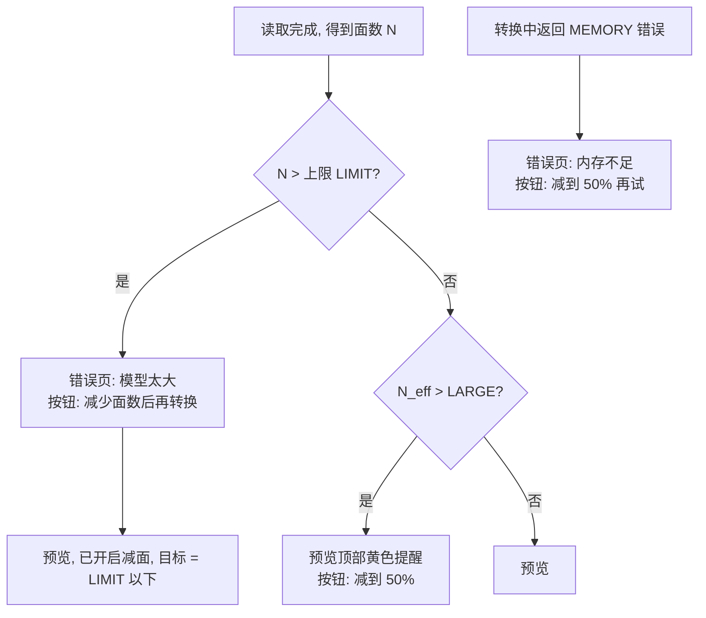

# STL2STP 手机版 · 界面设计规范 v0.1

> 适用范围：iOS 优先（iPhone + iPad），以后可能做 Android。框架未定（SwiftUI 或 Flutter），本规范与框架无关。
> 配套文件：`prototype/index.html`（可点击原型）、`screenshots/`（各屏截图）、`strings_zh.json` / `strings_en.json`（文案表，由 `tools/build_strings.py` 生成）。
> 文中所有数值，包括文件名、面数、大小和时间，都是**示例**：要么由原型内置的演示网格算出，要么按桌面基准换算。上线前要在真机上重新标定。

---

## 1. 设计原则

1. **一条主路径，3 次点击**：导入 → 预览并一键转换 → 分享或存到“文件”。默认设置就能得到和电脑版一致的结果。
2. **高级设置默认收起**：用户先从 3 个预设里选（推荐、文件更小、更严格），想细调再展开“高级设置”。手动改了任何一项，预设就显示为“自定义”。
3. **提前告诉用户代价**：转换前给出预计用时和文件大小。模型较大时主动建议减面；导出 IGES 时提醒“打开后是曲面”；IGES 文件信息里有中文时提醒会被去掉。
4. **本机处理**：所有转换都在设备上完成，不上传。这是卖点，也写进了引导页和设置页。
5. **遵循 Apple HIG**：用系统组件、SF Symbols 和语义颜色；支持深色模式、动态字体（Dynamic Type）和 VoiceOver；点击区域不小于 44×44 pt；iPad 用分栏布局。

## 2. 用户流程

### 2.1 主流程

```mermaid
flowchart LR
  A([启动]) --> B{首次启动?}
  B -- 是 --> O1[引导 1] --> O2[引导 2] --> H
  B -- 否 --> H[首页]
  H -- 点"导入 STL 文件" --> FP[系统文件选择器]
  X[微信/QQ/文件 "用其他应用打开"] --> L
  D[iPad 拖入] --> L
  FP --> L[读取模型 load_stl]
  L -- 成功 --> P[预览 + 转换设置]
  L -- 失败 --> E1[错误页: 文件无效 / 空模型 / 太大 / 内存不足]
  P -- 点"转换为 STEP/IGES" --> C[转换中]
  C -- 完成 --> R[完成页]
  C -- 取消 --> CC[取消确认] -- 确认 --> E2[已取消] --> P
  C -- 失败 --> E3[错误页: 内存不足 / 无法保存 / 转换失败]
  R -- 分享… / 存到"文件" --> S[系统分享面板]
  R -- 再转一个 --> H
```

### 2.2 大模型和错误恢复



- `LARGE`：建议减面的阈值，原型里暂定 200,000 面。`LIMIT`：硬上限，暂定 2,000,000 面。两个值都是**占位**，要按设备内存实测后再定，可以按 `ProcessInfo.physicalMemory` 分档。
- 免费额度（如果有）用完后弹出购买页，详见 §4.14。

### 2.3 历史记录

首页“最近转换”显示最近 3 条，“全部”进入历史页。点击一条会再次打开分享面板；左滑可以选“再次分享”或“删除”。源文件已被删除的条目显示为灰色，并标注“文件已不存在”。

## 3. 信息架构

```
App
├── 引导（首次，2 屏）
├── 首页（导入入口 + 最近转换）  ← 根页面
│   ├── 微信/QQ 导入说明（底部弹出面板）
│   ├── 预览 + 转换设置
│   │   ├── 高级设置（同页折叠展开，不另开页面）
│   │   ├── 转换中（全屏，不可返回，只能取消）
│   │   ├── 完成页 → 系统分享面板
│   │   └── 错误页
│   ├── 转换记录
│   └── 设置
│       ├── 购买 / 恢复购买（占位）→ 购买页
│       └── 开源许可
```

iPad 采用两栏：左栏是首页内容，宽 340pt；右栏是预览和设置，3D 视图在左、选项在右。转换中、完成页和错误页在右栏显示。

## 4. 逐屏说明

> 每屏标注：截图文件、路由（在原型中打开 `prototype/index.html#/<路由>`）、元素、状态、交互和无障碍要点。文案引用文案表的 key，括号里是中文。

### 4.1 引导 1　`01_onboarding_1` · `#/onboarding1`
- 右上角“跳过”（`common.skip`）直接进入首页。
- 插画：左边是三角网格立方体，右边是实体立方体，中间用箭头连接，下方标注“STL”和“STEP / IGES”。插画只做装饰，VoiceOver 跳过。
- 标题用 Large Title（`onboarding.1.title`：把 STL 变成可编辑的 CAD 文件）；正文用 Body，次要色（`onboarding.1.body`）。
- 页码点：2 个，当前页的点拉长显示。
- 主按钮“下一步”。支持左右滑动翻页。

### 4.2 引导 2　`02_onboarding_2` · `#/onboarding2`
- 标题“三步完成”。
- 3 行步骤，每行一个彩色图标块（44pt）加步骤序号和文案：`onboarding.2.step1/2/3`。
- 蓝色信息条，配锁图标：“所有文件都在手机本地处理，不会上传。”
- 主按钮“开始使用”。点击后记下“已看过引导”，以后不再显示。

### 4.3 首页　`04_home` · `#/home`；空状态 `03_home_empty` · `#/home?empty=1`
| 元素 | 说明 |
|---|---|
| 导航栏 | 无标题，右侧齿轮按钮进入设置（SF Symbol `gearshape`） |
| 大标题 | “STL2STP” + 副标题“让网格模型重新可编辑” |
| 导入卡片 | 整张卡片都能点：蓝色圆角图标（`square.and.arrow.down`）、“导入 STL 文件”、“支持 ASCII 和二进制 STL”。点击打开系统文件选择器，只允许 STL 类型 |
| 文字按钮 | “从微信 / QQ 导入？”，点击弹出说明面板（4.4） |
| 最近转换 | 最多 3 条：格式色块（STEP 蓝、IGES 橙）+ 文件名 + 时间和大小 + 箭头；右上角“全部”进入历史页 |
| 空状态 | 没有记录时显示时钟图标、“还没有转换记录”和“转换过的文件会显示在这里，方便再次分享。” |

- **iPad**：导入卡片里多一行“或把 STL 文件拖到这里”。文件拖到窗口上时，卡片显示 3pt 蓝色描边作为放置高亮。
- **从外部打开**：从微信、QQ 或“文件”用“用其他应用打开”或“拷贝到 STL2STP”进来时，不管当前在哪个页面，都直接进入“读取中”，然后到预览页。如果正在转换，先弹提示“当前转换完成后再打开”。
- **读取中**：在首页上方盖一层半透明遮罩，显示转圈和“正在读取模型…”（`import.loading`）。读取超过 1 秒时显示进度（`load_stl` 有进度回调）和取消按钮。

### 4.4 微信 / QQ 导入说明（底部面板）　`05_import_help_sheet` · `#/home?sheet=help`
- 面板高度为中等（`.medium` detent），顶部有拖动条，标题“从微信 / QQ 导入”，右上角“完成”。
- 3 个编号步骤：`import.help.step1..3`。
- 底部提示 `import.help.files`。

### 4.5 预览和转换　`06_preview` / `07_preview_options` · `#/preview`
从上到下：
1. **导航栏**：返回、文件名居中（过长时中间省略）、右侧“换一个文件”图标（`doc`）。
2. **3D 预览**：高 250pt，圆角 16，背景是浅色渐变（深色模式下是深灰渐变）。
   - 手势：单指旋转（轨迹球），双指缩放（0.4 到 4 倍），双指平移（可选），双击复位。
   - 左上角标签：“二进制 STL”或“ASCII STL”。
   - 右上角两个 40pt 浮动按钮：复位视角（`arrow.counterclockwise`）、显示网格线（`grid`，开关）。
   - 底部提示：“单指旋转 · 双指缩放 · 双击复位”，首次进入显示 3 秒后淡出（原型里一直显示）。
   - 渲染：平面着色，面法线光照，一盏主光加环境光，需要时显示描边。超过 50 万面时只用简化代理网格来显示，不影响转换。
3. **网格统计**（2×2 网格）：三角面、顶点、尺寸 X × Y × Z、文件大小。下方说明“STL 不带单位，尺寸按文件中的数值显示（通常是 mm）”。数字用等宽数字（tabular numbers）。
4. **大模型提醒**（条件显示，`09_large_model_warning`）：有效面数超过 `LARGE` 时，在统计下方显示黄色提醒条，文案是 `warn.large.body`，带“减到 50%”按钮。点击后开启减面，比例设为 50%，并展开高级设置。
5. **导出格式**：分段控件 STEP | IGES，默认 STEP（可以在设置里改）。下方一行说明会随选项变化。选了 IGES 时多显示一个蓝色信息条，提醒“打开后是一组曲面”（`warn.iges.surfaces`）。
6. **转换方式**：3 张预设卡片（单选），并排显示。
   | 预设 | 图标 | 说明 | 参数 |
   |---|---|---|---|
   | 推荐（默认） | `star` | 与电脑版一致，速度快 | 原版模式，不减面，不合并共面，校验开 |
   | 文件更小 | `arrow.down.right.and.arrow.up.left` | 减面 50%，合并共面 | 原版模式，减面 50%，合并共面开，校验开 |
   | 更严格 | `checkmark.shield` | 缝合成实体，多个零件时选它，约慢一倍 | 缝合模式，不减面，不合并共面，校验开 |

   参数和任何预设都不一致时，标题旁显示“自定义”标签，3 张卡片都不选中。
7. **高级设置**（折叠行）：左侧箭头展开时转 90°，右侧显示当前预设名。展开内容见 4.6。
8. **底部固定栏**：上面一行小字“预计用时约 N 秒，文件约 X MB”，右侧注明“估算值，实际以设备为准”；下面是主按钮“转换为 STEP”或“转换为 IGES”（闪电图标），高 50pt，圆角 12。

**状态**：正常；大模型；IGES；IGES 加中文文件信息；减面后面数没达到目标（转换后在完成页提示）。

### 4.6 高级设置（展开）　`08_advanced_settings` · `#/preview?adv=1`
| 分组 | 控件 | 默认 | 说明文案 |
|---|---|---|---|
| 减少面数 | 开关 + 滑块（5% 到 95%，步长 5，默认 50%） | 关 | 滑块上方实时显示“保留 50%（约 N 面）”；下方说明 `advanced.simplify.desc` |
| 转换模式 | 分段控件：原版 / 缝合 | 原版 | 下方说明随选项变化，见 `advanced.mode.*.desc` |
| | 开关：合并共面 | 关 | `advanced.merge.desc` |
| | 开关：导出后校验 | 开 | 选 IGES 时开关置灰，并显示“IGES 暂不支持校验” |
| 文件信息（可选） | 4 个文本框：作者、单位 / 公司、产品名称、描述 | 全部留空 | 占位文字“留空”；下方说明“写入文件头……默认留空” |
| | 文字按钮：恢复默认 | | 恢复为“推荐”预设，并清空文件信息 |

- 4 个文本框的最大长度：IGES 每项不超过 195 字节（核心库会截断）；STEP 建议在界面上限制为 200 个字符。
- **IGES 中文提醒**（`10_iges_chinese_meta_warning`）：格式是 IGES 且任一文本框含非 ASCII 字符时，文本框下方显示黄色提醒“IGES 只支持英文字符，中文等字符会被去掉”。转换时由 App 层去掉这些字符（见 §8 的待办 1）。
- 进阶参数**不在界面上显示**：缝合容差（固定 1e-6）、时间戳（固定为当前 UTC，由核心库生成）。
- 设置是否记住：预设和格式记成“上次使用”（可以在设置里改成固定默认）；文件信息只在设置里“默认文件信息”填了才会预填。

### 4.7 转换中　`11_converting` · `#/converting`（原型里会实时播放进度）
- 导航栏只显示标题“正在转换”，没有返回按钮，不能下滑关闭。
- 中间是进度环（168pt，线宽 12），中间显示百分比（整数）。
- 下面是输出文件名和“已用 N 秒”。
- 阶段列表（按实际启用的步骤显示）：读取模型 → 减少面数（启用时）→ 生成 CAD 面 → 写入文件 → 校验文件（STEP 且开启校验时）。已完成显示绿色对勾，当前阶段显示蓝点并加粗，未开始的为灰色。
- 底部小字“请保持 App 在前台，切到后台可能会中断”，下面是红字按钮“取消转换”。
- 总进度按阶段权重合成：读取 10、减面 10、生成面 50、写入 20、校验 10。每个阶段内用 C 回调的 `fraction`。回调频率可能很高，UI 刷新最多每秒 20 次。
- 屏幕常亮：转换期间关闭自动锁屏（`isIdleTimerDisabled = true`）。切到后台时申请后台任务时间，到期前没完成就取消，并在下次回到前台时显示“已取消”。
- **VoiceOver**：进度环是 progressbar，朗读“转换进度 62%”，每变化 10% 播报一次。

### 4.8 取消确认　`12_cancel_confirm` · `#/converting?p=0.62&confirm=1`
- 系统 Alert，标题“确定要取消吗？”，正文“当前进度不会保留。”，按钮“继续转换”（默认，加粗）和“取消转换”（红色，destructive）。
- 弹出期间转换继续在后台跑，确认后才让取消回调返回 1。

### 4.9 完成　`13_done` · `#/done`
- 右上角“完成”回到首页。
- 绿色大对勾，标题“转换完成”。
- 结果卡：格式色块、输出文件名（与源文件同名，扩展名 `.step` 或 `.igs`）；4 项数据：文件大小、用时、实体数（IGES 显示“—”）、CAD 面数（取自 `stl2stp_topology`）。
- 状态条：
  - STEP 且校验通过：绿色“校验通过，文件可以正常打开”。
  - 校验关闭：灰字“未校验”。
  - IGES：蓝色“IGES 打开后是曲面，需要在 CAD 中缝合成实体”。
  - `STL2STP_WARNING_PARTIAL`：黄色“有 N 个三角形无法转换，已跳过”。
  - `STL2STP_WARNING_TARGET_NOT_REACHED`：黄色“无法再减少，已减到 N 面”。
- 按钮：主按钮“分享…”（系统分享面板）；次按钮“存到‘文件’”（系统导出选择器）；文字按钮“再转一个”。
- 底部小字：“发到电脑：用微信‘文件传输助手’或隔空投送”。
- 完成时触发一次成功触感反馈（`UINotificationFeedbackGenerator.success`）。

### 4.10 系统分享面板　`14_share_sheet` · `#/done?sheet=share`
原型里只是示意，实际直接调系统分享面板（`UIActivityViewController` / `ShareLink`）。分享的是文件 URL，类型标为 STEP（`public.step` 或自定义 UTI）或 IGES。

### 4.11 错误页（4 种主要状态 + 2 种兜底）
统一布局：返回按钮、大圆形图标（88pt）、标题（Title 2）、正文（次要色）、底部主按钮加文字按钮。

| 截图 / 路由 | 触发（C 返回值） | 图标 / 色 | 标题 | 主按钮 | 次按钮 |
|---|---|---|---|---|---|
| `15_error_bad_file` · `#/error?type=format` | `ERROR_FORMAT`，或 `ERROR_IO`（读取阶段） | 文档 / 红 | 无法读取这个文件 | 换一个文件 | 返回 |
| `#/error?type=empty` | `ERROR_EMPTY` | 立方体 / 橙 | 模型里没有可用的面 | 换一个文件 | 返回 |
| `16_error_too_big` · `#/error?type=too_big` | 读取后面数超过 `LIMIT`（App 自己判断） | 放大框 / 橙 | 模型太大 | 减少面数后再转换 | 返回 |
| `17_error_out_of_memory` · `#/error?type=memory` | `ERROR_MEMORY`，或收到系统内存警告后主动取消 | 内存条 / 红 | 内存不足 | 减到 50% 再试 | 复制错误详情 |
| `18_cancelled` · `#/error?type=cancelled` | `ERROR_CANCELLED` | 停止 / 灰 | 已取消 | 回到预览 | 换一个文件 |
| `#/error?type=io` | `ERROR_IO`（写出阶段） | 文件夹 / 红 | 无法保存文件 | 重试 | 返回 |
| `#/error?type=generic` | `ERROR_OCCT` / `ERROR_INTERNAL` / `ERROR_ARGUMENT` | 警告 / 红 | 转换失败（代码 N） | 重试 | 复制错误详情 |

“复制错误详情”会把 `stl2stp_last_error()` 的内容、错误码、面数和设备型号复制到剪贴板，方便用户发给客服。

### 4.12 转换记录　`19_history` · `#/history`
- 大标题“转换记录”，右上角红字“清空记录”（点击后先弹确认）。
- 列表行与首页相同。左滑出现“再次分享”（蓝）和“删除”（红）。
- 页脚说明：“记录和文件只保存在本机，删除 App 后会一起删除”。
- 存储：输出文件放在 `Application Support/Outputs/`；记录用 JSON 或 SQLite 保存，每条包括文件名、格式、大小、时间、参数快照和源文件名。默认保留最近 50 条，超过的自动删除。

### 4.13 设置　`20_settings` · `#/settings`
分组（Inset Grouped 列表）：
1. **购买**（虚线框表示占位）：当前版本“免费版（占位）”→ 购买页；恢复购买。
2. **默认转换设置**：默认格式（STEP / IGES）、默认方式（推荐 / 文件更小 / 更严格 / 上次使用）、默认文件信息（4 个文本框）。
3. **外观**：跟随系统 / 浅色 / 深色；语言：跟随系统（iOS 上跳转到系统的 App 语言设置）。
4. **关于**：版本号、隐私“全部本机处理，不上传”、开源许可、意见反馈（邮件或网页，待定）。
5. 页脚：“转换引擎：stl2stp-core，基于 Open CASCADE Technology”。
6. 单独一组：红字“清空转换记录”。

### 4.14 购买页（占位）　`22_paywall_placeholder` · `#/paywall`
- **明确标注为占位**：页面顶部有黄色横幅“【占位】价格、购买方式和免费额度都还没有确定，这里只是版式示意”，价格相关元素都加了橙色虚线框。
- 内容：App 图标、“解锁完整版”、4 项权益（每项后面标“待定”）、“免费版：【额度待定】”、主按钮“购买（价格待定）”、“恢复购买”、“以后再说”。
- 什么时候弹出：从设置页进入，或超出免费额度时（额度规则待定）。没有决定任何价格或额度。
- 实现：iOS 用 StoreKit 2（一次性买断用 Non-Consumable）；Flutter 用 `in_app_purchase`。

### 4.15 开源许可　`21_licenses` · `#/licenses`
- OCCT 8.0.1：GNU LGPL 2.1 + Open CASCADE 例外；声明文字 `licenses.occt.notice`；“查看许可证全文”（随包附带 LGPL-2.1 全文和 OCCT_LGPL_EXCEPTION.txt）。
- 黄色待办条：**iOS 静态链接 LGPL 库的合规方式需上架前确认**（例如提供目标文件以便用户重新链接，或改成动态 framework）。
- stl2stp-core：基于原 stl2stp 项目改写，许可证【待确认】。
- 其他第三方库：视最终框架补充。

### 4.16 iPad 分栏　`24_ipad_split_light/dark` · `?device=ipad#/ipad`
- 左栏宽 340pt：首页内容，含拖放提示。
- 右栏：导航栏显示文件名；内容分成两列，比例 1.25 : 1。左列是 3D 视图（铺满高度）和统计，右列是格式、预设、高级设置和转换按钮。
- 支持分屏和侧拉（Split View / Slide Over），窄宽度时回落到 iPhone 的单栏布局。
- 文件可以从“文件”App 或其他 App 拖到任意位置导入。

### 4.17 动态字体　`23_preview_dynamic_type_xl_light` · `?text=xl#/preview`
所有文字都跟随系统字号。原型里用 1.35 倍模拟大号字。规则如下：
- 3 张预设卡片在辅助功能字号（AX1 及以上）下改为竖排，一行一张。
- 统计网格在 AX3 及以上改为单列。
- 底部转换按钮里的文字可以换行，按钮高度随内容变化，最小 50pt。
- 数字一律用等宽数字。

## 5. 无障碍
- **VoiceOver 标签**：3D 预览朗读“3D 预览，示例_支架.stl，可旋转缩放”（`a11y.viewer`），并提供“复位视角”自定义操作；预设卡片是单选按钮，朗读“推荐，已选中，与电脑版一致，速度快”；开关朗读名称、说明和状态；进度见 4.7。
- 焦点顺序和视觉顺序一致；底部固定按钮放在最后。
- **颜色**：正文对比度不低于 4.5:1。黄色提醒条用深棕字 `#8A4B00` 配 `#FFF4E5` 底，对比度约 7:1。状态不只靠颜色区分，都带图标和文字。
- **减弱动态效果**：开启“减弱动态效果”后关掉进度环动画和卡片过渡，改成直接切换。
- **触感反馈**：完成时用 success；出错时用 error；切换预设时用 selection。

## 6. 设计令牌（Design Tokens）

### 6.1 颜色（语义名 → 浅色 / 深色）
| Token | 浅色 | 深色 | 对应 iOS 语义色 |
|---|---|---|---|
| accent | #007AFF | #0A84FF | systemBlue（可换品牌色） |
| success | #34C759 | #30D158 | systemGreen |
| warning | #FF9500 | #FF9F0A | systemOrange |
| danger | #FF3B30 | #FF453A | systemRed |
| bg | #F2F2F7 | #000000 | systemGroupedBackground |
| surface | #FFFFFF | #1C1C1E | secondarySystemGroupedBackground |
| surface-2 | #F2F2F7 | #2C2C2E | tertiarySystemGroupedBackground |
| fill | rgba(120,120,128,.12) | rgba(120,120,128,.24) | tertiarySystemFill |
| fill-2 | rgba(120,120,128,.20) | rgba(120,120,128,.36) | secondarySystemFill |
| label | #000000 | #FFFFFF | label |
| label-2 | rgba(60,60,67,.60) | rgba(235,235,245,.60) | secondaryLabel |
| label-3 | rgba(60,60,67,.30) | rgba(235,235,245,.30) | tertiaryLabel |
| separator | rgba(60,60,67,.29) | rgba(84,84,88,.65) | separator |
| warn-bg / warn-fg | #FFF4E5 / #8A4B00 | #3A2A10 / #FFD08A | 自定义 |
| info-bg / info-fg | #EAF2FF / #0A4FB3 | #0F2547 / #9CC4FF | 自定义 |
| viewer-bg | #EEF2F8→#DCE3EE 渐变 | #1E2430→#111419 渐变 | 自定义 |
| mesh | #6E91CD（着色基色） | #7896C8 | 自定义 |
| STEP 标签 | info-bg / info-fg | 同左 | 自定义 |
| IGES 标签 | warn-bg / warn-fg | 同左 | 自定义 |

### 6.2 字体（iOS 默认 Large 档；中文用 PingFang SC，西文用 SF Pro）
| 样式 | 字号 / 行高 (pt) | 字重 | 用途 |
|---|---|---|---|
| Large Title | 34 / 41 | Bold | 首页、历史、设置、引导标题 |
| Title 1 | 28 / 34 | Bold | 完成页标题、购买页 |
| Title 2 | 22 / 28 | Bold | 错误页标题 |
| Title 3 | 20 / 25 | Semibold | 导入卡片、分区标题 |
| Headline | 17 / 22 | Semibold | 列表主文字（强调）、按钮 |
| Body | 17 / 22 | Regular | 正文、列表 |
| Callout | 16 / 21 | Regular | — |
| Subheadline | 15 / 20 | Regular | 副标题、提醒条 |
| Footnote | 13 / 18 | Regular | 说明、分组页脚 |
| Caption 1 | 12 / 16 | Regular | 预设说明、提示 |
| 数字 | 同所在样式 | 同所在样式 | 统一用等宽数字 `monospacedDigit()` |

Flutter 端用同一套字号，`TextScaler` 跟随系统；中文字体回落到系统默认。

### 6.3 间距、圆角和尺寸
- 间距（4pt 网格）：4 / 8 / 12 / 16（页面左右边距）/ 20 / 24 / 32。
- 圆角：小 8（标签、小按钮）；中 12（卡片、分组列表、主按钮）；大 16（3D 视图、结果卡）；特大 22（导入卡片）；底部面板顶部 14（系统默认）。
- 尺寸：主按钮高 50；列表行最小 44；开关 51×31；预览浮动按钮 40；进度环 168；错误页图标 88；3D 视图在 iPhone 上高 250。
- 阴影：浅色模式下卡片阴影很轻（0 1 3 / 0 4 16，8% 黑），深色模式不用阴影。

## 7. 组件清单
| 组件 | 用在 | SwiftUI | Flutter |
|---|---|---|---|
| PrimaryButton / SecondaryButton / PlainButton / DestructiveButton | 各页 | `Button` + `.borderedProminent` / `.bordered` / `.plain` + `.controlSize(.large)` | `FilledButton` / `FilledButton.tonal` / `TextButton`（Cupertino 风格可用 `CupertinoButton.filled`） |
| ImportDropCard | 首页 | 自定义 View + `.onDrop(of:[.stl])` + `.fileImporter` | `GestureDetector` + `file_picker`；iPad 拖放用 `super_drag_and_drop` |
| HistoryRow | 首页、历史 | `List` 行 + `.swipeActions` | `ListTile` + `flutter_slidable` |
| MeshViewer | 预览 | `SceneView`（SceneKit）或 RealityKit `RealityView` | `flutter_scene` / `flutter_gl`，或用 `webview` 加 three.js（见 §9） |
| StatGrid | 预览、完成 | `Grid` | `GridView` / `Table` |
| SegmentedControl | 格式、模式 | `Picker(.segmented)` | `CupertinoSlidingSegmentedControl` / `SegmentedButton` |
| PresetCard（单选） | 预览 | 自定义 + `.accessibilityAddTraits(.isSelected)` | 自定义 + `Semantics(selected:)` |
| DisclosureSection | 高级设置 | `DisclosureGroup` | `ExpansionTile` |
| ToggleRow / SliderRow / TextFieldRow | 高级设置、设置 | `Toggle` / `Slider` / `TextField` in `Form` | `CupertinoListTile` + `CupertinoSwitch` / `Slider` / `CupertinoTextField` |
| Banner（warn / info / success） | 多处 | 自定义 `Label` + 背景 | 自定义 `Container` |
| ProgressRing + StageList | 转换中 | `Circle().trim()` + `ProgressView` | `CustomPaint` / `CircularProgressIndicator(value:)` |
| ConfirmAlert | 取消 | `.alert` / `.confirmationDialog` | `showCupertinoDialog` |
| StatusScreen（图标 + 标题 + 正文 + 按钮） | 完成页、错误页 | 自定义；iOS 17 起可用 `ContentUnavailableView` 做参考 | 自定义 |
| Sheet | 导入说明、购买页 | `.sheet` + `.presentationDetents` | `showModalBottomSheet` / `CupertinoSheetRoute` |
| ShareAction | 完成页、历史 | `ShareLink` / `UIActivityViewController` | `share_plus` |
| SaveToFiles | 完成页 | `.fileExporter` / `UIDocumentPickerViewController(forExporting:)` | `file_picker` 的 `saveFile`，或平台通道 |

SF Symbols 对照：导入 `square.and.arrow.down`、分享 `square.and.arrow.up`、文件夹 `folder`、设置 `gearshape`、复位 `arrow.counterclockwise`、网格 `square.grid.3x3`、转换 `bolt.fill`、推荐 `star`、更小 `arrow.down.right.and.arrow.up.left`、严格 `checkmark.shield`、警告 `exclamationmark.triangle`、信息 `info.circle`、停止 `stop.circle`、内存 `memorychip`、锁 `lock`。Material 对应：`file_download`、`ios_share`、`folder`、`settings`、`restart_alt`、`grid_on`、`bolt`、`star`、`compress`、`verified_user`、`warning`、`info`、`stop_circle`、`memory`、`lock`。

## 8. UI 控件与 C API 的对应关系（`core/include/stl2stp/stl2stp.h`）

| UI | C API / 字段 | 取值 |
|---|---|---|
| 导入文件 | `stl2stp_create()` → `stl2stp_load_stl(h, path, &cb)` | path 是拷进沙盒后的本地路径（UTF-8） |
| 统计：三角面 / 顶点 | `stl2stp_get_mesh_stats` → `faces` / `vertices` | |
| 统计：尺寸 | `maximum[i] - minimum[i]` | 不带单位 |
| 统计：文件大小 | 由 App 读取文件属性 | 不经过 C API |
| ASCII / 二进制标签 | **C API 目前没有提供** | 待办 2：App 先读文件头判断（以 `solid` 开头，且大小 ≠ 84 + 50×N），或者给核心库加 `format` 字段 |
| 减少面数开关 + 比例 | `stl2stp_simplify(h, target_faces, &cb)` | `target_faces = round(faces × ratio)`；关闭时不调用。要在导出前调用；如果用户之后又改了比例，要重新 `load_stl` 再简化，或者由核心库加“恢复原网格”接口（待办 3） |
| 导出格式 STEP | `stl2stp_export_step(h, out, &opt, &cb, &topo)` | AP214 |
| 导出格式 IGES | `stl2stp_export_iges(...)` | |
| 转换模式 | `opt.mode` | 原版 = `STL2STP_MODE_ORIGINAL`（默认）；缝合 = `STL2STP_MODE_SEWING` |
| 合并共面 | `opt.merge_coplanar` | 0 / 1，默认 0 |
| 缝合容差 | `opt.sewing_tolerance` | 不在界面上显示，用 `stl2stp_default_export_options()` 的默认值 1e-6 |
| 作者 / 单位 / 产品 / 描述 | `opt.author` / `organization` / `product` / `description` | 空字符串或 NULL 表示留空；IGES 时先由 App 去掉非 ASCII 字符（待办 1） |
| 时间戳 | `opt.timestamp` | 不在界面上显示，传 NULL 用当前 UTC |
| 导出后校验 | `stl2stp_read_step(h, out, &cb, &topo2)` | 只用于 STEP；`topo2.solids ≥ 1` 且 `faces > 0` 算通过 |
| 完成页：实体 / CAD 面 | `stl2stp_topology.solids` / `.faces` | |
| 进度环 | `stl2stp_callbacks.progress(fraction, user)` | 按阶段权重合成总进度 |
| 取消 | `stl2stp_callbacks.cancelled(user)` 返回非 0 | 回调在工作线程上执行，读一个原子标志即可 |
| 错误页 | 返回值 `stl2stp_status` + `stl2stp_last_error(h)` | 对应关系见 §4.11 |
| 完成页黄色提示 | `STL2STP_WARNING_PARTIAL` / `STL2STP_WARNING_TARGET_NOT_REACHED` | |
| 预计用时 / 大小 | App 本地估算 | 桌面基准：1.98 万面约 4 秒、STEP 约 48 MB，即约 2.4 KB/面、0.2 ms/面。原型里手机按 ×1.5 估，缝合 ×2，校验 ×1.3。**都是占位系数，要真机标定** |

**核心库待办（UI 需要）**
1. IGES 的非 ASCII 文件信息：由核心库或 App 层统一去掉，并返回提示。
2. 提供 STL 格式类型（ASCII / 二进制），可以在 `mesh_stats` 里加字段。
3. 简化后恢复原网格：`stl2stp_reset_mesh`，或者支持复制句柄，方便用户反复调比例。
4. 可选：返回连通部件数。数量大于 1 时可以推荐“更严格”（原版模式会把多个物体放进同一个实体）。
5. 可选：预测输出大小或面数的接口，让估算更准。
6. 写 STEP 时 OCCT 会往 stdout 打印统计信息，集成前要关掉。

**线程模型**：所有 C 调用都放在一个串行后台队列（或 Dart isolate）里执行。一个 handle 同一时间只给一个任务用。进度回调从工作线程切回主线程更新界面，并做节流。

## 9. 实现说明

### 9.1 SwiftUI（推荐用于纯 iOS）
- **工程**：最低支持 iOS 16（为了 `ShareLink`、`NavigationStack` 和 `presentationDetents`），用 SwiftUI App 生命周期。
- **桥接**：`stl2stp.h` 是纯 C 头文件，用 module map 或桥接头直接在 Swift 里调用，不一定需要 Objective-C++。OCCT 编译成 iOS 静态库或 xcframework（arm64 真机 + arm64 模拟器），再和 stl2stp-core 一起打包成 `Stl2StpCore.xcframework`。
- **回调**：用 `Unmanaged.passUnretained(self).toOpaque()` 传 `user_data`；C 函数指针用 `@convention(c)` 闭包；取消用 `ManagedAtomic<Bool>`（swift-atomics）或加锁的 Bool。
- **文件进入**：
  - Info.plist 声明 `CFBundleDocumentTypes`，导入 UTI：STL（`public.standard-tesselated-geometry-format`，再加扩展名 `.stl` 的自定义 UTI 兜底）。
  - `LSSupportsOpeningDocumentsInPlace = NO`，统一拷进沙盒再处理。
  - 用 `.onOpenURL` 接收微信、QQ 的“用其他应用打开”。
  - 导出时声明 STEP（`.step`/`.stp`）和 IGES（`.igs`/`.iges`）的 exported UTI。
- **选择 / 保存**：`.fileImporter(allowedContentTypes:[.stl])`、`.fileExporter`，或 `UIDocumentPickerViewController(forExporting:)`。
- **分享**：`ShareLink(item: url)`；需要指定弹出位置时，iPad 用 `UIActivityViewController` 加 `popoverPresentationController`。
- **3D 预览**：
  - 用 SceneKit `SCNView`：从 C 层取顶点和索引（需要加只读接口），或者 App 自己用 Swift 再解析一遍 STL，建 `SCNGeometry`。
  - 相机用 `allowsCameraControl = true`（自带旋转、缩放和双击复位）；材质用 `lightingModel = .physicallyBased`（或 `.lambert`）；网格线用 `fillMode = .lines` 叠一层。
  - 超过 50 万面时先用 `simplify` 生成显示代理。
  - RealityKit 也可以，但 SceneKit 对静态模型更简单。
- **后台和内存**：`beginBackgroundTask`；`UIApplication.didReceiveMemoryWarningNotification` 时设置取消标志并提示内存不足。
- **本地化**：把 `strings_*.json` 转成 String Catalog（`.xcstrings`）。`{name}` 占位符改成 `%@`，或者用 `String(localized:)` 的插值写法。
- **购买**：StoreKit 2，加 `Transaction.currentEntitlements`。

### 9.2 Flutter（iOS 和 Android 共用一套代码）
- **工程**：Flutter 3.x，界面组件以 Cupertino 为主；Android 端可以改用 Material 3，同一套设计令牌。
- **FFI**：
  - 用 `dart:ffi` 加 `ffigen`，从 `stl2stp.h` 生成绑定。iOS 用 `DynamicLibrary.process()`（静态库链接进 Runner），Android 用 `DynamicLibrary.open('libstl2stp.so')`。
  - 把转换放进 `Isolate.run()`，避免阻塞 UI。
  - 进度回调用 `NativeCallable.listener`（Dart 3.1 起），可以跨线程投递，不用自己写 SendPort 胶水代码。
  - 取消用 `Pointer<Int32>` 共享标志，C 回调读它；或者用 `NativeCallable.isolateLocal` 同步返回。
- **文件**：
  - `file_picker` 选择 STL。外部“用其他应用打开”在 iOS 上要配 `CFBundleDocumentTypes`，用 `receive_sharing_intent` 或 `app_links` / 平台通道接收 URL；Android 上配 intent-filter，包括 `ACTION_VIEW` 和 `ACTION_SEND`，以及 `application/octet-stream` 和 `*/*` 加 `.stl` 扩展名。
  - 分享用 `share_plus`（iPad 必须传 `sharePositionOrigin`）；保存到“文件”用 `file_picker.saveFile`，或调 `UIDocumentPicker` 的平台通道。
  - iPad 拖放用 `super_drag_and_drop`。
- **3D 预览**（可选方案，按优先级）：
  1. `flutter_scene`（Impeller 3D，纯 Flutter）：性能好，但 API 还在变化，要验证 iOS 和 Android 兼容性。
  2. `three_dart` / `flutter_gl`：用法类似 three.js，生态不如前者稳定。
  3. 用 `webview_flutter` 嵌入 three.js 的 STLLoader 和 OrbitControls：最快能跑起来，但大模型要经 JS 传输，内存翻倍，只适合小模型。
  4. 平台视图嵌入原生 SceneKit（iOS）和 Filament / SceneView（Android）：效果最好，工作量最大。
  - 建议先用方案 1，同时准备方案 4 作为退路。
- **本地化**：把 JSON 转成 ARB（`app_zh.arb` / `app_en.arb`）。`{name}` 写法与 ARB 的 ICU 占位符兼容，可以直接用。
- **深色模式**：用 `ThemeMode.system`，两套 `ColorScheme`/`CupertinoThemeData` 取自 §6。
- **动态字体**：用 `MediaQuery.textScalerOf`；布局按 §4.17 断点切换。
- **购买**：`in_app_purchase`。

### 9.3 两种方案都要注意
- **Mac 和 Xcode**：iOS 打包、签名和上架都离不开 Mac 和 Xcode，Flutter 也一样；还需要 Apple 开发者账号。
- **OCCT LGPL 合规**：iOS 只能静态链接（或用自己打包的动态 framework）。上架前要确认 LGPL 2.1 的合规做法，见 §4.15。
- **包体**：OCCT 只编译 FoundationClasses、ModelingData、ModelingAlgorithms 和 DataExchange 四个模块，去掉调试符号，并启用 `-Os` 和 dead strip，再测一下包体大小。
- **测试**：用原型路由对应的状态写 UI 快照测试，SwiftUI 用 swift-snapshot-testing，Flutter 用 golden tests。

## 10. 文案
- `strings_zh.json`（主语言）和 `strings_en.json` 一共 200 个 key，key 按页面加点号分层，比如 `preview.stats.triangles`。
- 两份文件和 `prototype/strings.js` 都由 `tools/build_strings.py` 生成，文案只改这个脚本。
- 语气：口语化，短句；尽量少用术语，“STEP”“IGES”和“STL”保留英文；不用感叹号。
- 中文引号统一用“”，例如 存到“文件”。

## 11. 原型和截图
- 打开 `prototype/index.html`（双击就能在浏览器里打开，不需要服务器）。左侧面板可以跳到任意页面，切换浅色 / 深色、中文 / English、iPad 布局和大字号。
- 原型里能点的：导入（会直接载入示例文件）、旋转和缩放 3D 视图、切格式、选预设、展开高级设置、开关和滑块、在 IGES 下输入中文触发提醒、转换（模拟进度）、取消、完成、分享面板。
- 原型 URL 参数：`?bare=1`（不显示边框，截图用）、`theme=light|dark`、`lang=zh|en`、`text=xl`、`device=ipad`；hash 路由参数：`file=bracket|large`、`fmt=step|iges`、`preset=recommended|smaller|strict`、`adv=1`、`meta=zh`、`p=0.62`（冻结进度）、`confirm=1`、`sheet=help|share`、`type=format|empty|too_big|memory|cancelled|io|generic`、`scroll=px`。
- 重新生成截图：`tools/shoot_all.sh`（headless Chrome，2 倍分辨率，393×852 pt）；总览图由 `tools/overview.html` 渲染。
- 截图里的数值：示例_支架.stl 的面数、顶点、尺寸和大小，都由原型内置的演示网格实时计算；“示例_大模型.stl”的 60 万面、“示例_超大模型.stl”的 350 万面都是虚构的示例值；历史记录里的文件名和大小都是示例。

## 12. 未决事项
1. 框架：SwiftUI 还是 Flutter（等 Bo 决定）。
2. 价格、购买方式和免费额度（购买页目前是占位）。
3. `LARGE` 和 `LIMIT` 阈值，以及估算系数，需要真机标定。
4. 核心库待办 1～6（§8）。
5. OCCT LGPL 合规方案和 stl2stp 原项目的许可证。
6. App 图标和品牌色：目前用系统蓝，名称暂定 STL2STP。
7. 意见反馈渠道：邮件、网页还是微信群。
