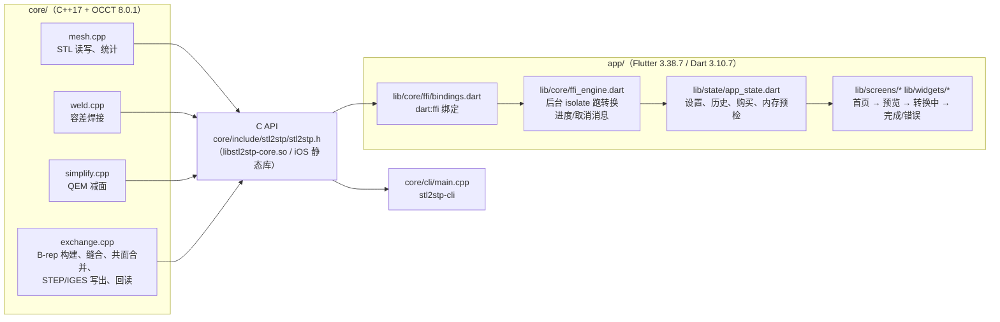

# STL2STP 维护交接文档（总入口）

> 写给接手维护的同事。目标：**只看这一套文档，就能在一台空白机器上 1:1 复现当前的构建、测试和 App**，并知道下一步该做什么。
> 写作日期 2026-10-21。文中命令都在开发机（Windows + WSL2 Ubuntu 20.04）上实际运行过；没跑过、只能间接核对的内容会明确标出【未验证】或【间接核对】。
> 本文是索引和概要，细节分在 `docs/handoff/` 下的子文档里；已有的专题文档（`docs/*.md`）直接链接，不重复抄写。

## 目录

1. [项目概述与来历](#1-项目概述与来历)
2. [架构总览](#2-架构总览)
3. [仓库结构、分支与提交规则](#3-仓库结构分支与提交规则)
4. [十分钟上手（已有环境时）](#4-十分钟上手已有环境时)
5. [复现检查清单（空白机器 → 完全相同的构建）](#5-复现检查清单空白机器--完全相同的构建)
6. [子文档索引](#6-子文档索引)
7. [已有专题文档索引](#7-已有专题文档索引)
8. [当前状态一览](#8-当前状态一览)
9. [优先级最高的后续工作（摘要）](#9-优先级最高的后续工作摘要)
10. [本交接文档没能验证的内容](#10-本交接文档没能验证的内容)

---

## 1. 项目概述与来历

- **原项目**：gitee 上的 `zigzagwag/stl2stp`，一个 Windows MFC 桌面工具，基于 Open CASCADE Technology（OCCT）7.x，把 STL 三角网格转换成 STEP / IGES。原版的转换逻辑、行号和隐含参数的逐条分析见 [original-conversion.md](original-conversion.md)。
- **本项目的目标**：
  1. 把原版的转换算法抽成一个**与平台无关的 C/C++ 核心库**（`core/`，OCCT 8.0.1），带稳定的 C API；
  2. 修掉原版的问题（无效实体、乱码 metadata、时间戳、共面合并容差等），并补上测试（122 个 CTest）；
  3. 在核心库之上做一个**手机 App**（Flutter，`app/`），先在 Linux 桌面上完整跑通，再到 Mac 上出 iOS 版，计划在闲鱼等渠道销售。
- **与原版桌面工具的区别**（完整清单见 [CHANGES-from-original.md](CHANGES-from-original.md)）：

| 方面 | 原版（MFC 桌面） | 本项目 |
|---|---|---|
| 平台 | Windows | 核心库：Linux / macOS / iOS（C API）；App：Flutter（Linux 桌面已跑通，iOS 待 Mac） |
| OCCT | 7.x | 8.0.1，从源码编译 |
| 转换模式 | 只有一种（共享边直接拼 shell/solid） | ORIGINAL（同原版，默认）+ SEWING（缝合，更严格） |
| 无效输入 | 照样写出“实体”，可能无效 | 校验 + 自动修复，开放网格写成曲面并告警 |
| 微小缝隙 | 只按精确坐标合并顶点 | 默认按 1e-6×对角线容差焊接（可关） |
| 共面合并 | 角度容差 1e-12 rad，斜面几乎合不了 | 1e-4 rad，合并后无效会自动撤销 |
| 减面 | QEM | QEM（修了若干问题，闭合网格保持闭合） |
| 文件信息 | 硬编码作者等字段，中文乱码 | 默认留空；STEP 用 `\X2\` 无损写中文；IGES 只写 ASCII |
| 时间戳 | 本地时间、无时区 | UTC，`...Z` |
| 取消 / 进度 | 无 | 有（C 回调） |

## 2. 架构总览



- 核心库对外只有一个头文件 `stl2stp.h`（12 个函数，见 [code-walkthrough.md §2](handoff/code-walkthrough.md#2-c-api-逐项说明)）。
- App 通过 `dart:ffi` 调用；耗时的转换跑在**单独的 isolate**里，UI 线程只收进度消息，取消通过一块共享的 `int32` 内存传给 C 回调。
- 完整的端到端时序图（含进度、取消、错误）在 [code-walkthrough.md §5](handoff/code-walkthrough.md#5-端到端时序含进度取消错误)。

## 3. 仓库结构、分支与提交规则

### 3.1 目录

```text
.
├── core/                 核心库（C++17 + OCCT）
│   ├── include/stl2stp/stl2stp.h   C API（唯一公开头文件）
│   ├── src/              mesh.cpp weld.cpp simplify.cpp exchange.cpp exchange_disabled.cpp internal.hpp
│   ├── cli/main.cpp      命令行工具 stl2stp-cli
│   ├── tests/            CTest（122 个）：test_core.cpp test_review.cpp test_metadata.cpp test_c_api.c fixtures.cpp
│   └── tools/run-sanitizer-ctest.sh   ASan/UBSan 跑测试（有输出上限）
├── app/                  Flutter App（只在 app/flutter 分支）
│   ├── lib/              Dart 源码（core/ ffi/ screens/ widgets/ state/ purchase/ platform/ theme/ l10n/）
│   ├── test/             单元 + 组件测试（55 个）
│   ├── integration_test/ 真实核心库端到端测试（3 个），顺带截图
│   ├── assets/i18n/      中英文文案（zh/en 来自设计稿，app_zh/app_en 来自 tool/app_strings.py）
│   ├── assets/licenses/occt/   OCCT LGPL-2.1 + 例外 原文
│   ├── tool/             calib/（估算标定）app_strings.py sync_strings.sh ios/build_ios_core.sh
│   ├── linux/ ios/ ...   平台工程
├── design/ui/            UI 设计稿：ui-spec.md、HTML 原型、截图、文案表（来自 ios/ui-design 分支）
├── docs/                 文档（本文件、handoff/、各专题文档）
├── reference/            原版源码（只读参考，**不入库**，见 .gitignore）
└── build/                所有构建产物（不入库）
```

### 3.2 分支（写作时的 head）

仓库**只在本地**，没有任何 remote，不要添加 remote、不要 push（交付方式见 [mac-setup-guide.md §3](mac-setup-guide.md#3-把仓库拷到-mac不用远端)：打包整个目录或 `git bundle`）。

| 分支 | head | 用途 | 和 main 的关系 |
|---|---|---|---|
| `main` | `cfee62c`（+ 本交接文档的提交，见 §8） | 核心库的集成分支：所有已接受的 core 改动 | — |
| `app/flutter` | `f998ebe`（+ 本交接文档的提交） | **日常开发分支**：main 的全部内容 + Flutter App + 设计稿 | 基于 main `cfee62c`，领先 19 个提交 |
| `core/weld` | `cfee62c` | 容差焊接（已合并到 main，与 main 相同） | 0/0 |
| `core/simplify-closed` | `1385bb5` | QEM 闭合网格回归测试（已合并） | main 领先 2 |
| `core/utc-timestamp` | `97d6d87` | STEP 时间戳转 UTC（已合并） | main 领先 3 |
| `core/fixes` | `e823516` | 代码审查后的修复：校验/修复、共面容差、IGES ASCII 等（已合并） | main 领先 4 |
| `core/extract` | `4f49890` | 早期“把原版算法抽成库”的分支 | 基于旧 main `6004e50`，**有 1 个提交未进 main**（只改了测试/文档里的示例作者名），可以不合 |
| `ios/ui-design` | `ccf5fe2` | UI 设计稿（design/ui） | 基于 `6004e50`，内容已经合进 app/flutter |
| `validate/cad` | `b9f8620` | 外部 CAD 校验脚本 `core/tools/cadcheck/` | 基于 `97d6d87`，领先 2，**未合并**（只是工具） |

worktree（Windows 上的 git，路径以开发机为例，接手者可自定）：

| 目录 | 分支 |
|---|---|
| `D:\stl2stp-ios` | main（主 checkout） |
| `D:\stl2stp-flutter` | app/flutter |
| `D:\stl2stp-weld` | core/weld |
| `D:\stl2stp-simplify` | core/simplify-closed |

> worktree 是用 **Windows 的 git** 建的（路径是 `D:/...`），在 WSL 里对这些目录跑 `git` 会报路径错误。请在 PowerShell 里用 `git -C D:\stl2stp-flutter ...`。构建和测试在 WSL 里通过 `/mnt/d/...` 进行，两者不冲突。

### 3.3 在哪个分支上工作、怎么合并

- **改 App**：直接在 `app/flutter` 上提交。
- **改核心库**：从 `main` 拉 `core/<主题>` 分支 → 完成并通过 122 个 CTest → 合并（或快进）到 `main` → 再把 `main` 合并进 `app/flutter`（历史上就是这样做的，例如 `bc487de merge main (core/weld) into app/flutter`）。
- **只改文档**：在 `app/flutter` 上提交；如果文档也适用于核心库，再把同样的改动 cherry-pick 到 `main`（本交接文档就是这样做的）。
- 合并方向永远是 core 分支 → main → app/flutter，不要反向把 App 合进 main（main 应保持不含 Flutter）。

### 3.4 提交身份

- 仓库用**仓库级**的 `user.name` / `user.email`（不改全局配置）。当前是：

```powershell
git -C D:\stl2stp-ios config user.name     # 致知屋
git -C D:\stl2stp-ios config user.email    # zhizhiwu@local
```

- 接手者可以继续用 `致知屋 <zhizhiwu@local>`，也可以改成自己的：`git -C D:\stl2stp-ios config user.name "<你的名字>"`（worktree 共享同一个配置）。
- 生成文件里的“作者”元数据默认留空；示例和测试里统一用 `致知屋` 作中文示例作者。
- 历史已经整理过一次（早期提交的作者信息被统一改写），所以 [CHANGES-from-original.md §1.4](CHANGES-from-original.md) 里列出的旧 hash（如 `d1a8084`）已不存在，以 `git log` 为准。

## 4. 十分钟上手（已有环境时）

假设已按 [environment.md](handoff/environment.md) 装好 WSL、OCCT、Flutter。以下在 WSL 里执行（`D:` 盘对应 `/mnt/d`）：

```bash
cd /mnt/d/stl2stp-flutter                      # app/flutter 的 worktree
export CMAKE_BUILD_PARALLEL_LEVEL=4
# 1) 核心库 + CLI + 122 个测试
TMPDIR=$PWD/build/tmp cmake -S core -B build/rel -G Ninja -DCMAKE_BUILD_TYPE=Release \
  -DCMAKE_C_COMPILER=gcc-10 -DCMAKE_CXX_COMPILER=g++-10 -DOCCT_ROOT=$HOME/occt-install
cmake --build build/rel
ctest --test-dir build/rel -j4                 # 期望：100% tests passed, 0 tests failed out of 122
# 2) App 用的共享库
TMPDIR=$PWD/build/tmp cmake -S core -B build/core-shared -G Ninja -DCMAKE_BUILD_TYPE=Release \
  -DCMAKE_C_COMPILER=gcc-10 -DCMAKE_CXX_COMPILER=g++-10 -DOCCT_ROOT=$HOME/occt-install \
  -DBUILD_SHARED_LIBS=ON -DBUILD_TESTING=OFF
cmake --build build/core-shared
# 3) App
export PATH=/mnt/d/dev/flutter-linux/bin:$PATH PUB_CACHE=/mnt/d/dev/pub-cache
cd app && flutter pub get && flutter analyze && flutter test      # 期望：No issues found / All tests passed!（55）
flutter build linux --release && build/linux/x64/release/bundle/stl2stp_app
```

所有命令、参数、期望输出和耗时见 [build-test.md](handoff/build-test.md)。

## 5. 复现检查清单（空白机器 → 完全相同的构建）

逐项打勾。“期望值”都是开发机上的实测值。

| # | 步骤 | 期望值 / 校验方法 | 详见 |
|---|---|---|---|
| 1 | Windows 10/11 + WSL2，`wsl --install -d Ubuntu-20.04` | `lsb_release -d` → `Ubuntu 20.04.6 LTS` | [environment.md §2](handoff/environment.md#2-wsl-与-ubuntu) |
| 2 | apt 装 gcc-10/g++-10、ninja、clang-10、GTK 等 | `g++-10 --version` → `10.5.0`；`ninja --version` → `1.10.0` | [environment.md §3](handoff/environment.md#3-系统软件包apt) |
| 3 | CMake 3.26.4（官方二进制，放 `/usr/local`） | `cmake --version` → `3.26.4` | [environment.md §3.3](handoff/environment.md#33-cmake) |
| 4 | 下载 OCCT V8.0.1 源码 | 45,129,885 字节；sha256 `6297cc55…68d53c18` | [environment.md §4](handoff/environment.md#4-occt-801从源码编译) |
| 5 | 编译安装 OCCT 到 `~/occt-install` | 12 核约 20 分钟（1196 s）；安装 123 MB，48 个 `libTK*.so` | 同上 |
| 6 | 编译核心库 + CTest | `122/122` 通过 | [build-test.md §1](handoff/build-test.md#1-核心库cmake--ctest) |
| 7 | 编译 `libstl2stp-core.so`（共享库） | 342,584 字节；sha256 `3cc9d486…542aedc`（**可复现**：同一提交、同一工具链，换目录重编逐字节相同，见下） | [build-test.md §1.3](handoff/build-test.md#13-app-用的共享库) |
| 8 | Flutter 3.38.7 Linux SDK | `flutter --version` → `3.38.7`，framework `3b62efc2a3`，engine `78fc3012e4`，Dart `3.10.7` | [environment.md §5](handoff/environment.md#5-flutter-3387) |
| 9 | `flutter pub get` | 98 个包，版本锁在 `app/pubspec.lock` | 同上 |
| 10 | `flutter analyze` / `flutter test` | `No issues found!` / `All tests passed!`（55） | [build-test.md §3](handoff/build-test.md#3-app-测试) |
| 11 | 集成测试（真实核心库） | 3 个全部通过，`build/app-shots/` 生成 27 张截图 + `results.txt` | [build-test.md §3.3](handoff/build-test.md#33-集成测试真实核心库) |
| 12 | `flutter build linux --release` | bundle 约 43 MB（`libflutter_linux_gtk.so` 33.9 MB、`libapp.so` 6.98 MB） | [build-test.md §4](handoff/build-test.md#4-linux-发布包) |
| 13 | 用 CLI 转一个立方体 | `export solids=1 shells=1 faces=12`，STEP 24,350 字节 | [build-test.md §2](handoff/build-test.md#2-命令行工具-stl2stp-cli) |

**关于可复现性（已实测）**：在同一提交上，用同一套工具链（gcc-10 10.5.0、CMake 3.26.4、Ninja 1.10.0、同一个 `~/occt-install`）把 `libstl2stp-core.so` 编到一个全新目录，`sha256sum` 和 `cmp` 都与原产物完全相同（2026-10-21，耗时 15 s，`-j4`）。所以在另一台机器上，只要 OCCT 安装路径相同（RPATH 里写的是 `~/occt-install/lib` 的绝对路径，也就是用户名要一样），就应能得到同一个 sha256；用户名不同时 RPATH 字符串不同，sha256 必然不同，这时用“输出文件对比”来验证：同一个 STL、同一个 `--timestamp`，两边生成的 STEP 应该逐字节相同（方法见 [build-test.md §6](handoff/build-test.md#6-怎样证明两台机器的构建等价)）。OCCT 本身和 Flutter 产物没有做逐字节对比【未验证】。

## 6. 子文档索引

| 文档 | 内容 |
|---|---|
| [handoff/environment.md](handoff/environment.md) | 从空白机器搭环境：WSL、apt 包（含版本）、CMake、OCCT 8.0.1 精确编译参数、Flutter SDK、Python 工具、FreeCAD；Mac/iOS 路线概要 |
| [handoff/build-test.md](handoff/build-test.md) | 构建、运行、测试的全部命令；CLI 全部参数；演示模式；标定脚本；文案工具；cadcheck；截图生成；**全部测试的逐条目录**；怎样新增测试 |
| [handoff/code-walkthrough.md](handoff/code-walkthrough.md) | 逐模块代码导读：核心库源码、C API 每个函数/字段/枚举/错误码、线程与所有权规则；Dart 绑定、isolate 协议、服务、状态管理、页面；端到端时序图 |
| [handoff/ui-reference.md](handoff/ui-reference.md) | **完整 UI 参考**：每个页面、每个状态、每个选项（范围/默认值/作用）、预设、估算、错误对照表、内存提示、帮助、设置、购买页、分栏、滑动、拖放、分享、语言、无障碍、深浅色；截图；页面 ↔ 源文件 ↔ 文案键 |
| [handoff/strings.md](handoff/strings.md) | 全部 300 个中英文文案键（自动生成） |
| [handoff/algorithms.md](handoff/algorithms.md) | 核心算法：ORIGINAL 与 SEWING、焊接、共面合并、QEM、metadata 与 `\X2\` 转义、UTC 时间戳、校验、已知 OCCT 限制 |
| [handoff/validation.md](handoff/validation.md) | 验证证据及如何重做：CTest、FreeCAD、纯 Python STEP 检查、pcurve 检查、SolidWorks 测试包、待做的 Parasolid 检查 |
| [handoff/operations.md](handoff/operations.md) | 内购（模拟商店 / StoreKit、商品 ID、免费额度）、估算与内存系数及重新标定、iOS 后台与内存原生代码、版本发布流程 |
| [handoff/decisions.md](handoff/decisions.md) | 决策记录：选了什么、备选、理由、什么情况下应重新考虑 |
| [handoff/recipes.md](handoff/recipes.md) | 操作手册：加核心选项、加文案、改预设、重新标定、加导出格式、升级 OCCT/Flutter、改商品 ID/价格、发版 |
| [handoff/risks-faq-glossary.md](handoff/risks-faq-glossary.md) | 已知问题、风险与限制、性能范围（面数 vs 时间/内存）、法律事项、闲鱼买家常见问题、术语表 |
| [handoff/roadmap.md](handoff/roadmap.md) | 按优先级排列的路线图（工作量、依赖、验收标准），分“需要 Mac / 不需要 Mac / 需要决定” |
| [handoff/troubleshooting.md](handoff/troubleshooting.md) | 常见构建错误、PowerShell 与 WSL 的引号问题、磁盘空间 |
| [handoff/screenshots/](handoff/screenshots/) | 27 张参考截图（由集成测试生成，共约 4.2 MB） |

## 7. 已有专题文档索引

| 文档 | 内容 | 什么时候看 |
|---|---|---|
| [core-api.md](core-api.md) | C API 的权威说明：返回码、共面容差、焊接、QEM 语义、两种模式、metadata 与时间戳、进度/取消/线程、CMake 链接 | 改核心库或 FFI 时 |
| [CHANGES-from-original.md](CHANGES-from-original.md) | 与原版的全部差异、环境、OCCT 编译记录、逐分支的修改说明（§9 core/fixes、§11 core/weld） | 想知道“为什么和原版不一样” |
| [original-conversion.md](original-conversion.md) | 原版 MFC 代码的转换流程逐行分析 | 对比原版行为 |
| [core-validation.md](core-validation.md) | 核心库实测记录：CTest、拓扑统计、耗时 | 回归对比 |
| [build-linux.md](build-linux.md) | Linux 构建、OCCT recipe、RPATH | 编译问题 |
| [flutter-app.md](flutter-app.md) | App 目录、FFI 设计、本机运行、估算模型与标定数据、购买框架、分享、焊接开关、分栏/滑动、许可、后台与内存 | 改 App 时 |
| [mac-setup-guide.md](mac-setup-guide.md) | 在 Mac 上继续 iOS：Xcode、编 iOS 版 OCCT、模拟器、真机、上架、StoreKit、原生后台/内存代码（§9.3）、LGPL 合规 | 拿到 Mac 后 |
| [../design/ui/ui-spec.md](../design/ui/ui-spec.md) | UI 设计规范（页面、文案风格 §10） | 改界面时 |
| [../app/tool/calib/README.md](../app/tool/calib/README.md) | 估算标定脚本 | 重新标定时 |

## 8. 当前状态一览

| 项目 | 状态 |
|---|---|
| 核心库 | 完成；CTest 122/122；ASan/UBSan 脚本可用（见 [troubleshooting.md](handoff/troubleshooting.md)） |
| CLI | 完成：info / simplify / convert / readback |
| Flutter App（Linux 桌面） | 功能完整：导入、预览、预设、高级设置、估算、内存预检、转换/取消、完成/错误页、历史（滑动分享/删除）、帮助、设置、许可、模拟购买、iPad 分栏布局；55 个测试 + 3 个集成测试通过 |
| iOS | Dart 端就绪；iOS 构建脚本 `app/tool/ios/build_ios_core.sh` 和原生代码说明已写好，**未在 Mac 上执行过**【未验证】 |
| 外部 CAD 验证 | FreeCAD 1.0：全部 STEP 有效；SolidWorks / Parasolid：测试包已准备，**结果待反馈** |
| 购买 | 框架完成（模拟商店已测试）；StoreKit 实现未测试；价格、免费额度未定 |
| 法务 | LGPL 静态链接合规方案、ICP 备案、Apple 开发者账号：**待决定**（见 [risks-faq-glossary.md §4](handoff/risks-faq-glossary.md#4-法律与合规)） |

本交接文档的提交：见 `git log --oneline -- docs/HANDOFF.md docs/handoff`（app/flutter 和 main 各一份，内容相同）。

## 9. 优先级最高的后续工作（摘要）

完整的路线图（工作量、依赖、验收标准）见 [roadmap.md](handoff/roadmap.md)。

1. **【需要决定】** 价格、免费额度、是否上架 App Store（决定开发者账号、ICP 备案、LGPL 合规方式）。
2. **【需要 Mac】** 在 Mac 上跑通 iOS：`build_ios_core.sh` → 模拟器 → 真机；把 iOS 原生后台/内存代码加进 `AppDelegate.swift`。
3. **【需要 Mac】** 真机标定：估算的 `deviceFactor` 和内存模型。
4. **【不需要 Mac】** 拿到 SolidWorks 对测试包的结果，若有问题修正核心库。
5. **【不需要 Mac】** 让 OCCT 写 STEP 时不再往 stdout 打彩色统计（`Message` 静默）。
6. **【不需要 Mac】** 统一版本号（设置页写死 `0.1.0`，`pubspec.yaml` 是 `1.0.0+1`）。

## 10. 本交接文档没能验证的内容

- **OCCT 的编译目录和源码包已被清理**，所以无法重新读取当时的 `CMakeCache.txt`。编译参数取自 [CHANGES-from-original.md §3.2](CHANGES-from-original.md)（当时与 CMakeCache 核对过），这次只能和安装目录里的 `OpenCASCADEConfig.cmake` 交叉核对（Release、Shared、`-fexceptions -fPIC -Wall -Wextra`、TCL/FreeType/FreeImage/TBB/FFmpeg 全部关闭——一致）【间接核对】。源码包重新下载后 sha256 与记录一致。没有重新编译 OCCT（约 20 分钟、会写 home 目录）。
- **空白机器**：没有在一台真正的空白机器上从头走一遍；各步骤是在现有开发机上逐条核对的（版本号、dpkg 记录、CMakeCache、文件大小、sha256）。
- **深色模式**：代码支持（跟随系统/浅色/深色），没有截图核对过外观。
- **iOS / Mac**：全部未执行。手机上的速度、内存占用、StoreKit 购买都没测过。
- **SolidWorks / Parasolid**：没有这些软件，结果待反馈。NIST STEP File Analyzer 需要额外的 IFCsvr 组件，未做。
- **OCCT 和 Flutter 产物的逐字节可复现性**：只验证了 `libstl2stp-core.so`。
