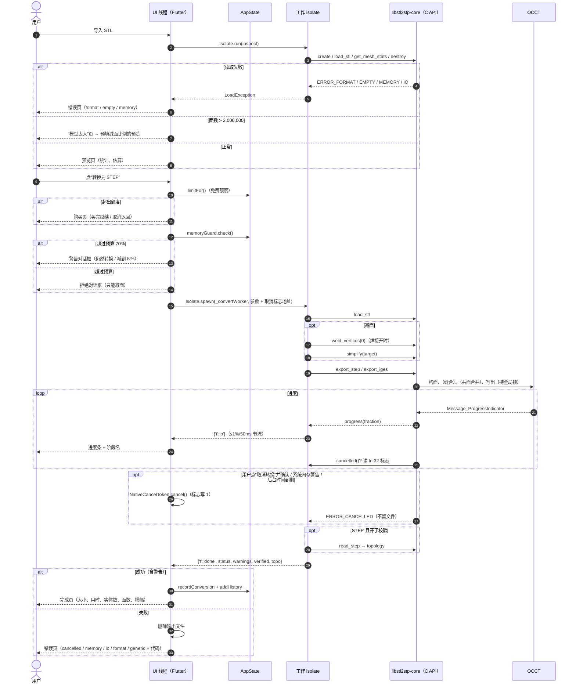

# 代码导读（逐模块）

[← 返回总入口](../HANDOFF.md)

> 行数为写作时的值，帮助判断模块大小。C API 的权威说明在 [core-api.md](../core-api.md)，本页是导读和速查。

## 目录

1. [核心库源码](#1-核心库源码)
2. [C API 逐项说明](#2-c-api-逐项说明)
3. [线程、所有权与生命周期规则](#3-线程所有权与生命周期规则)
4. [Dart 端模块](#4-dart-端模块)
5. [端到端时序（含进度、取消、错误）](#5-端到端时序含进度取消错误)
6. [状态管理与持久化](#6-状态管理与持久化)
7. [平台相关代码](#7-平台相关代码)

---

## 1. 核心库源码

| 文件 | 行数 | 职责 |
|---|---|---|
| `core/include/stl2stp/stl2stp.h` | 116 | 唯一公开头文件：C ABI，`extern "C"` |
| `core/src/internal.hpp` | 157 | 内部类型：`Point`、`Mesh`（顶点 + 三角形 + 标志）、`Error`（带状态码的异常）、`Progress`（进度/取消封装，节流并检查取消）、`OutputFile`（同目录临时文件 → 成功后 rename 的原子写出）、`WeldResult`、`stl2stp_handle`（持有 `Mesh` 和 `last_error` 字符串），以及 `protect()`——把所有 C++ 异常转成状态码，保证异常不会穿过 C ABI |
| `core/src/mesh.cpp` | 438 | `create/destroy/last_error/default_export_options`；STL 读取（二进制/ASCII 自动识别，`solid` 开头的二进制靠长度识别；截断文件读出完整部分并返回 PARTIAL）；精确坐标去重；网格统计；`simplify`、`save_stl` 的 C 入口 |
| `core/src/weld.cpp` | 207 | 容差焊接：`weld_tolerance()`（自动容差）、`weld_points()`（网格哈希，只处理开放边界顶点，不让三角形退化）、`stl2stp_weld_vertices` |
| `core/src/simplify.cpp` | 381 | QEM 减面（`simplify_mesh`）：二次误差度量 + 边折叠，保护开放边界和 link condition，结果与缩放无关 |
| `core/src/exchange.cpp` | 1041 | 一切与 OCCT 相关的：时间戳解析与 UTC 换算（`timestamp_value`）；STEP 字符串 `\X2\` 编码（`step_text`）和流式过滤器 `StepStringFilter`；IGES ASCII 化（`iges_ascii`）；OCCT 进度适配 `Indicator`；全局参数的 RAII 保存/恢复（`StaticSetting`、`IntegerSetting`）；全局锁 `exchange_mutex`（`std::timed_mutex`，等锁时仍轮询取消）；`make_original_shape`（ORIGINAL）、`make_sewing_shape`（SEWING）、`merge_shape`（共面合并 + 无效时撤销）；导出、回读的 C 入口 |
| `core/src/exchange_disabled.cpp` | 29 | `STL2STP_WITH_OCCT=OFF` 时的桩：三个导出/回读函数返回 `ERROR_OCCT` |
| `core/cli/main.cpp` | 193 | `stl2stp-cli`：参数解析（重复/缺值都报错）、计时输出、SIGINT → 取消 |
| `core/CMakeLists.txt` | | 选项（见 [build-test.md §1.1](build-test.md#11-cmake-选项)）、OCCT toolkit 选择、Linux RPATH（`--disable-new-dtags`） |

## 2. C API 逐项说明

### 2.1 函数（12 个）

| 函数 | 作用 | 返回 | 注意 |
|---|---|---|---|
| `stl2stp_handle* stl2stp_create(void)` | 创建句柄 | 句柄；内存不足时 NULL | 每个句柄持有一份网格 |
| `void stl2stp_destroy(stl2stp_handle*)` | 销毁 | — | 可以传 NULL |
| `const char* stl2stp_last_error(const stl2stp_handle*)` | 最近一次诊断（错误或警告说明，多条用 `; ` 分隔） | 库持有的字符串 | **不要 free**；下次修改该句柄或销毁后失效，要保存请立即拷贝；`handle=NULL` 返回全局诊断（如 create 失败） |
| `stl2stp_export_options stl2stp_default_export_options(void)` | 默认导出选项 | 按值返回的结构体 | **永远从它开始**再改字段，这样新版追加的字段有默认值 |
| `stl2stp_load_stl(h, path, callbacks)` | 读 STL（UTF-8 路径） | OK / WARNING_PARTIAL / ERROR_* | 替换句柄里原来的网格 |
| `stl2stp_get_mesh_stats(h, stats*)` | 顶点、边、面、包围盒 | OK / ERROR_EMPTY | |
| `stl2stp_weld_vertices(h, tolerance, merged*)` | 对已加载网格就地容差焊接 | OK / ERROR_ARGUMENT（NaN/Inf）/ ERROR_EMPTY | `tolerance<=0` 自动；`merged` 可为 NULL；**减面前调用**，让 QEM 看到闭合的接缝 |
| `stl2stp_simplify(h, target_faces, callbacks)` | QEM 减到目标三角形数 | OK / WARNING_TARGET_NOT_REACHED / ERROR_* | `target_faces=0` 是 ERROR_ARGUMENT；就地修改网格 |
| `stl2stp_save_stl(h, path, callbacks)` | 写二进制 STL | OK / ERROR_IO … | 原子写出 |
| `stl2stp_export_step(h, path, options, callbacks, topology*)` | 导出 STEP（AP214） | OK / WARNING_* / ERROR_* | `options=NULL` = 默认；`topology` 返回导出前 B-rep 的计数 |
| `stl2stp_export_iges(h, path, options, callbacks, topology*)` | 导出 IGES 5.3 | 同上；非 ASCII 元数据 → METADATA_CHANGED | |
| `stl2stp_read_step(h, path, callbacks, topology*)` | 回读 STEP，统计拓扑 | OK / ERROR_FORMAT … | 不修改句柄里的网格；用于“导出后校验” |

### 2.2 结构体

**`stl2stp_callbacks`**（整个可为 NULL，任一字段可为 NULL）

| 字段 | 类型 | 含义 |
|---|---|---|
| `progress` | `void (*)(double fraction, void* user_data)` | 进度 0..1，单调；成功的操作包含 0 和 1；在调用线程同步执行 |
| `cancelled` | `int (*)(void* user_data)` | 返回非 0 表示请求取消 |
| `user_data` | `void*` | 原样传回 |

**`stl2stp_mesh_stats`**：`vertices`、`edges`、`faces`（`uint64_t`），`minimum[3]`、`maximum[3]`（`double`，包围盒）。

**`stl2stp_topology`**：`solids`、`shells`、`faces`、`edges`、`vertices`（`uint64_t`）。

**`stl2stp_export_options`**（字段顺序即 ABI 顺序；结构体大小随版本变化，**库和调用方必须用同一版头文件一起编译**）

| 字段 | 类型 | 默认 | 范围 / 含义 | App 里对应 |
|---|---|---|---|---|
| `sewing_tolerance` | double | `1e-6` | 有限正数；SEWING 的缝合容差，也参与共面合并的线性容差（模型单位） | 不暴露，用默认 |
| `merge_coplanar` | int | 0 | 1 = 共面合并 | “合并共面”开关 |
| `mode` | `stl2stp_mode`（int32） | ORIGINAL | `STL2STP_MODE_ORIGINAL=0`、`STL2STP_MODE_SEWING=1`；其它值 → ERROR_ARGUMENT | “转换模式”分段控件 |
| `author` | const char* | NULL | UTF-8；NULL 和 `""` 都表示空 | 文件信息·作者 |
| `organization` | const char* | NULL | 同上 | 文件信息·单位/公司 |
| `product` | const char* | NULL | 同上 | 文件信息·产品名称 |
| `description` | const char* | NULL | 同上 | 文件信息·描述 |
| `timestamp` | const char* | NULL | NULL = 当前 UTC；ISO 8601 `YYYY-MM-DDTHH:MM:SS[.f][Z\|±HH:MM]`；`""` 无效 | 不暴露（总是当前时间） |
| `merge_angular_tolerance` | double | `1e-4` | 弧度，0 表示默认，允许 [0, 0.1] | 不暴露 |
| `strict_original` | int | 0 | 1 = 原版旧行为（不校验、不修复、不焊接） | 不暴露 |
| `weld_vertices` | int | 1 | 0 = 只按精确坐标合并 | “合并重合顶点”开关 |
| `weld_tolerance` | double | 0 | `<=0` 自动 = max(1e-6×对角线, 2×FLT_EPSILON×最大坐标)；NaN/Inf → ERROR_ARGUMENT | 不暴露（自动） |

库在第一次回调和取得全局锁**之前**把所有字符串复制成私有 `std::string`，所以调用方只需在调用期间保证内存有效。

### 2.3 状态码

正数 = 带说明的成功，负数 = 失败。数值永不重排，新码只追加。

| 码 | 值 | 含义 | 典型原因 |
|---|---|---|---|
| `STL2STP_OK` | 0 | 成功 | |
| `STL2STP_WARNING_PARTIAL` | 1 | 只读到了可用部分 | 文件截断、ASCII 语法不完整、零面积面被跳过 |
| `STL2STP_WARNING_TARGET_NOT_REACHED` | 2 | 减面没达到目标，保留了最好结果 | 网格太简单或受保护边界太多 |
| `STL2STP_WARNING_NOT_SOLID` | 3 | 网格不封闭，写成了开放 shell / 曲面，**没有实体** | STL 有破洞 |
| `STL2STP_WARNING_REPAIRED` | 4 | 输出有效，但输入被修复过 | 丢弃零面积三角形、统一/翻转朝向、焊接了顶点、非流形时自动改 SEWING、共面合并无效被撤销 |
| `STL2STP_WARNING_METADATA_CHANGED` | 5 | IGES 元数据含非 ASCII，已替换为 `?` | 中文作者名 |
| `STL2STP_ERROR_ARGUMENT` | -1 | 参数错误 | NULL、空路径、目标面数 0、非法公差/模式/时间戳 |
| `STL2STP_ERROR_IO` | -2 | 读写失败 | 文件不存在、目录不存在、磁盘满 |
| `STL2STP_ERROR_FORMAT` | -3 | 内容无效 | 不是 STL、没有有效三角形、非有限坐标、STEP 无可转移内容 |
| `STL2STP_ERROR_EMPTY` | -4 | 句柄里没有网格 | 未加载就导出 |
| `STL2STP_ERROR_CANCELLED` | -5 | 被取消 | 网格、目标文件、topology 都不变 |
| `STL2STP_ERROR_OCCT` | -6 | OCCT 构面/缝合/传输异常 | 极端畸形网格；或无 OCCT 的构建 |
| `STL2STP_ERROR_MEMORY` | -7 | 内存不足 | |
| `STL2STP_ERROR_INTERNAL` | -8 | 其它内部异常 | |

多个警告同时出现时只返回一个，优先级 **NOT_SOLID > REPAIRED > METADATA_CHANGED**，`last_error` 里列出全部说明。App 的映射见 [ui-reference.md §9](ui-reference.md#9-错误与状态对照表)。

## 3. 线程、所有权与生命周期规则

1. **同一句柄的所有调用必须串行**（包括 `last_error` 和 `destroy`）。不同句柄的网格操作可以并行。
2. 所有 OCCT 数据交换（构面、写出、回读）由库内的**全局锁**串行化，因为 OCCT 的 `Interface_Static` 是进程级全局设置。等锁期间仍会检查取消。应用自己若直接调用 OCCT，不受这个锁保护。
3. 每次导出用 RAII 保存并恢复修改过的 STEP/IGES 全局参数（成功、取消、异常路径都恢复）。
4. 回调在**调用线程**上同步执行；回调里**不得**重入本库、销毁句柄或抛异常（C++/ObjC/Swift）。UI 更新要转发到主线程（Dart 里通过 `SendPort`）。
5. 取消：跨线程用原子变量（Dart 端是一块 `calloc` 的 `Int32`）+ `cancelled` 回调。没有进度钩子的 OCCT 阶段（`ReadFile`、`UnifySameDomain::Build`、IGES `ComputeModel`、writer `Write`）只能在前后检查，**不能立即中断**；STEP 写盘每 1 MB 检查一次。
6. 导出和保存先写到目标目录里的临时位置，成功后 rename；失败或取消时清理，**不覆盖、不删除**已有目标。目标父目录不存在是 ERROR_IO。
7. 所有入口都 `noexcept`，异常转换为状态码。
8. `last_error` 指针归库所有（见 §2.1）。
9. 不要用 `-fshort-enums` 编译调用方（`stl2stp_mode` 必须是 4 字节，`test_c_api.c` 会检查）。

## 4. Dart 端模块

`app/lib/` 下，共约 5600 行。

### 4.1 核心桥接（`lib/core/`）

| 文件 | 行数 | 职责 |
|---|---|---|
| `ffi/bindings.dart` | 123 | 与 `stl2stp.h` 一一对应的 FFI 结构体（`Stl2StpCallbacks`、`Stl2StpMeshStats`、`Stl2StpTopology`、`Stl2StpExportOptions`）和函数查找；`errorOf(h)` 读 `last_error` |
| `ffi/native_library.dart` | 64 | 找核心库：`STL2STP_CORE_LIB` → Linux `<exe>/lib/libstl2stp-core.so` → 系统搜索路径；iOS/macOS 先查进程内符号（静态链接）；Android/Windows 预留 |
| `engine.dart` | 38 | 抽象接口 `ConversionEngine`（`inspect`、`convert`、`newCancelToken`、`isReal`）和 `CancelToken` |
| `ffi_engine.dart` | 366 | 真实引擎，见 §4.2 |
| `demo_engine.dart` | 92 | 演示引擎：Dart 自己解析 STL 统计，转换时按阶段模拟进度并写占位文件；用于测试和找不到核心库时 |
| `models.dart` | 301 | `CoreStatus`（状态码常量）、`ExportFormat`、`ConvertMode`、`Preset`、`ConvertSettings`（含 JSON、`withPreset`、`matchingPreset`、`targetFaces`、`verifyEffective`）、`MeshInfo`、`Topology`、`Stage`（read/simplify/build/write/verify 及权重 10/10/50/20/10）、`ConvertRequest`、`ConvertResult`、`ConvertProgress`、`overallProgress()`、`LoadException`、`stripNonAscii` |
| `stl_reader.dart` | 158 | Dart 端 STL 解析（预览用）：二进制/ASCII 识别、显示用抽稀、`PlaneCounter`（统计不同平面数，供“合并共面”估算） |
| `estimate.dart` | 243 | 估算器 `Estimator` + `Coefficients.calibrated`；`timeRangeKey()` 选择时间文案 |
| `memory_guard.dart` | 130 | 内存模型 `MemoryGuard`（峰值估计、warn/refuse 判断、建议减面比例）和 `MemoryBudget.detect()` |
| `sample_mesh.dart` | 98 | 内置示例模型（支架 28 三角形、闭合 UV 球） |
| `licenses.dart` | 36 | 把 OCCT 许可原文注册进 `LicenseRegistry` |
| `screenshot.dart` | 17 | 集成测试截图 |

### 4.2 后台 isolate 协议（`ffi_engine.dart`）

- `inspect(path)`：`Isolate.run(_inspectWorker)` —— 在临时 isolate 里 `create → load_stl → get_mesh_stats → destroy`，返回 Map；失败抛 `LoadException(status, message)`。同时主 isolate 读文件头判断 ASCII/二进制。
- `convert(request)`：`Isolate.spawn(_convertWorker, args)`，参数 Map：`port`、`lib`（库路径；iOS 为 null 表示进程内）、`cancel`（取消标志的内存地址）、`in`、`out`、`format`、`simplify`、`target`、`mode`、`merge`、`verify`、`weld`、`author/org/product/description`（IGES 时已在 Dart 端去掉非 ASCII）。
- 工作 isolate → 主 isolate 的消息：

| 消息 | 字段 | 何时 |
|---|---|---|
| 进度 | `{'t':'p', 's': Stage.index, 'f': 0..1}` | 节流：同一阶段变化 < 1% 且距上次 < 50 ms 则不发；阶段开始/结束强制发 |
| 结束 | `{'t':'done', 'status', 'error', 'failed': Stage.index?, 'warnings': [int], 'facesAfter': int?, 'verified': bool?, 'topo': [solids, shells, faces, edges, vertices]}` | 恰好一次 |

- 主 isolate 另外监听 `onError`、`onExit`：工作 isolate 崩溃或意外退出时以 `ERROR_INTERNAL` 结束（不会卡住）。
- 工作流程：`load_stl` → （开了减面：先 `weld_vertices(0)`（若焊接开）再 `simplify(target)`，记录 `facesAfter`）→ `export_step/iges`（导出回调前 70% 算“生成 CAD 面”，后 30% 算“写入文件”）→ （STEP 且开了校验：`read_step`，`verified = 成功 && faces>0 && (solids>=1 || 已知不封闭)`）。
- 结果状态：有警告时取第一个警告，否则 OK；任何负状态立即结束并带上 `failed` 阶段。**失败时主 isolate 删除输出文件**。
- 取消：`NativeCancelToken` 用 `calloc<Int32>()` 分配标志，UI 调 `cancel()` 写 1；C 的 `cancelled` 回调（`Pointer.fromFunction`，在工作 isolate 内执行）读这块内存。工作 isolate 阻塞在 FFI 里也能取消，不需要消息。
- 校验失败（`verified == false`）不算失败，完成页显示警告横幅。

### 4.3 状态与服务

| 文件 | 行数 | 职责 |
|---|---|---|
| `state/app_state.dart` | 231 | `AppState extends ChangeNotifier`：引擎、偏好、输出目录、历史、购买、免费额度、估算器、内存守卫；常量 `largeFaces = 200000`、`limitFaces = 2000000`；`outputPathFor()`（`<应用数据>/Outputs/<原名>.step`，重名加 ` (2)`）；`limitFor()`；`recordConversion()`（每日计数）；主题、语言、默认格式/预设/文件信息、内存预算覆盖等设置 |
| `state/history.dart` | 67 | `HistoryEntry` 和 `HistoryStore`（`history.json`） |
| `purchase/purchase_service.dart` | 58 | 抽象 `PurchaseService`、`PurchaseConfig`（`proProductId = 'com.stl2stp.app.pro'`）、`ProductInfo`、`PurchaseOutcome` |
| `purchase/free_tier.dart` | 50 | `FreeTierLimits`（`maxTriangles`、`dailyConversions`、`igesRequiresPro`、`metaRequiresPro`；默认 `none`） |
| `purchase/mock_purchase_service.dart` | 86 | 模拟商店（可模拟取消/失败/不可用） |
| `purchase/store_purchase_service.dart` | 122 | `in_app_purchase` 实现（StoreKit），**未测试** |
| `purchase/purchase.dart` | 21 | `createPurchaseService()` 选择实现 |
| `platform/background_task.dart` | 69 | iOS 后台任务桥（`MethodChannel`），其它平台空操作 |
| `platform/haptics.dart` | 21 | 触感反馈（iOS/Android） |
| `l10n/strings.dart` | 62 | `S`：加载 4 个 JSON，`t(key, params)` 做 `{name}` 替换；`SDelegate` |
| `theme/tokens.dart` | 124 | 浅色/深色设计令牌（颜色、圆角）和 `buildTheme()` |

### 4.4 页面与组件

| 文件 | 行数 | 页面 |
|---|---|---|
| `app.dart` | 77 | `Stl2StpApp`：`AppScope`（InheritedNotifier）包住 `MaterialApp`；主题、语言、截图边界；首屏 = 引导页或首页；命令行传入的文件 |
| `screens/onboarding_screen.dart` | 128 | 引导页（2 页） |
| `screens/home_screen.dart` | 349 | 首页（手机单栏 / 宽屏分栏）、导入卡片、微信/QQ 导入说明、示例按钮、最近转换 |
| `screens/flow.dart` | 215 | 流程函数：`pickStl`（系统选择器，失败时输入路径）、`openModel`（加载 → 预览或错误页 / 太大页）、`shareFile`、`saveToFiles` |
| `screens/preview_screen.dart` | 480 | 预览：3D 视图、统计、大模型警告、格式、预设、高级设置、估算、转换按钮 |
| `screens/memory_dialog.dart` | 53 | 内存警告/拒绝对话框，`ensureMemory()` |
| `screens/converting_screen.dart` | 269 | 转换中：进度、阶段、计时、取消确认、后台任务、内存紧张自动取消、结果跳转 |
| `screens/done_screen.dart` | 126 | 完成页 |
| `screens/error_screen.dart` | 100 | 错误页（7 种 `ErrorKind`） |
| `screens/history_screen.dart` | 53 | 全部历史、清空 |
| `screens/help_screen.dart` | 116 | 帮助页（10 个主题 + FAQ 6 条 + 隐私），可定位到主题 |
| `screens/settings_screen.dart` | 205 | 设置 |
| `screens/paywall_screen.dart` | 157 | 购买页、`ensureAllowed()` |
| `screens/licenses_screen.dart` | 89 | 开源许可（OCCT 说明、原文、Flutter 包许可） |
| `widgets/common.dart` | 215 | `Surface`、`InfoBanner`（info/success/warn/neutral）、`SectionHeader`、`StatCell`、`FormatTag`、`StatusIcon` 等 |
| `widgets/mesh_viewer.dart` | 224 | 自绘 3D 视图（单指旋转、双指缩放、双击复位、线框） |
| `widgets/history_list.dart` | 84 | 历史列表项（滑动分享/删除） |
| `widgets/stl_drop.dart` | 67 | 桌面拖放（`desktop_drop`） |

每个页面用到的文案键和 widget Key 见 [ui-reference.md §11](ui-reference.md#11-页面--源文件--文案键--widget-key)。

## 5. 端到端时序（含进度、取消、错误）

## 6. 状态管理与持久化

- 没有用第三方状态管理库：`AppState`（`ChangeNotifier`）通过 `AppScope`（`InheritedNotifier`）向下提供；`AppScope.of(context)` 订阅变化，`AppScope.read(context)` 只读取。页面内部状态用 `StatefulWidget`。
- `SharedPreferences` 键：`themeMode`（默认 system）、`language`（默认 `zh`）、`onboardingSeen`、`defaultFormat`、`defaultPreset`（默认 `'last'` = 上次使用的设置）、`defaultMeta`、`lastSettings`（JSON）、`memoryBudgetMB`（覆盖值）、`convDay` / `convCount`（每日次数）、模拟商店的购买标记。
- 文件：输出在 `getApplicationSupportDirectory()/Outputs/`，历史在同目录 `history.json`。Linux 上是 `$XDG_DATA_HOME/com.stl2stp.stl2stp_app/`（默认 `~/.local/share/...`）。

## 7. 平台相关代码

| 平台 | 位置 | 内容 |
|---|---|---|
| Linux | `app/linux/CMakeLists.txt` | 打包核心库（§build-test 1.3）；`runner/my_application.cc` 窗口标题 STL2STP、默认 430×900 |
| iOS | `app/ios/Runner/Info.plist` | 文档类型（可从微信/QQ“用其他应用打开”STL）、本地化；bundle id `com.stl2stp.stl2stpApp` |
| iOS | `app/ios/Runner/AppDelegate.swift` | 目前是 Flutter 默认；需按 [mac-setup-guide.md §9.3](../mac-setup-guide.md) 加入 `stl2stp/background` 和 `stl2stp/memory` 两个 MethodChannel |
| iOS | `app/tool/ios/build_ios_core.sh` | 编 iOS 静态 OCCT + 核心库并生成 xcconfig（未在 Mac 上运行过） |
