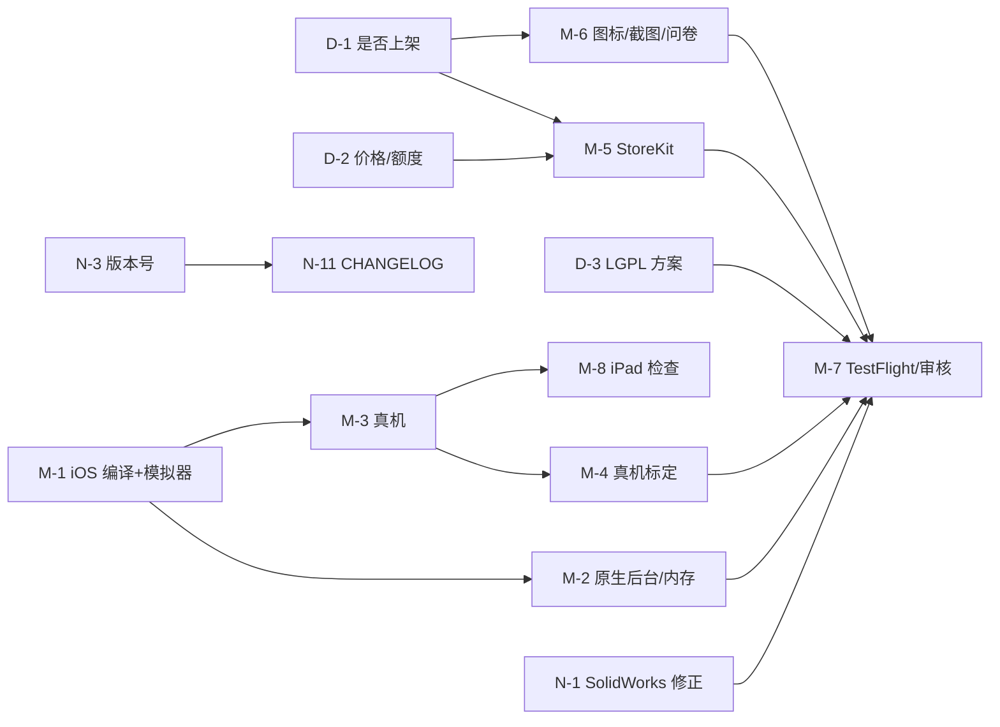

# 路线图（按优先级）

[← 返回总入口](../HANDOFF.md)

说明：
- **优先级**：P0 = 上架前必须；P1 = 上架后尽快；P2 = 有空再做。
- **工作量**：按一个熟悉本项目的人估算（人日）；“需要 Mac”的项目不含买设备、注册账号的等待时间。
- 分三类：**需要决定**（产品/法务，不是技术活）、**需要 Mac**、**不需要 Mac**（在现有 Windows + WSL 上就能做）。

## 目录

1. [需要决定](#1-需要决定)
2. [需要 Mac](#2-需要-mac)
3. [不需要 Mac](#3-不需要-mac)
4. [依赖关系图](#4-依赖关系图)

---

## 1. 需要决定

| ID | 优先级 | 事项 | 影响 | 决定后要做的事 |
|---|---|---|---|---|
| D-1 | P0 | 是否上架 App Store（还是只自用/闲鱼代转） | 决定后面全部 iOS 工作和费用 | 上架：注册开发者账号（¥688/年）、ICP 备案 |
| D-2 | P0 | 价格、免费额度（每日次数？面数上限？IGES/中文信息收费？） | 购买页现在是占位 | 改 `lib/purchase/free_tier.dart` 的 `FreeTierLimits` 和商品 ID（[operations.md §1](operations.md#1-内购模拟商店--storekit)） |
| D-3 | P0 | LGPL 合规方式：提供目标文件 / 动态 framework / OCCT 商业许可 | 不解决不能合规上架 | 见 [risks-faq-glossary.md §4](risks-faq-glossary.md#4-法律与合规) |
| D-4 | P1 | 是否合并 `validate/cad`（`core/tools/cadcheck`）到 main | 只影响工具 | `git merge validate/cad`，跑 ctest |
| D-5 | P2 | 是否做 Android | 需要 NDK 版 OCCT，工作量大 | 见 N-9 |

## 2. 需要 Mac

| ID | 优先级 | 事项 | 工作量 | 依赖 | 验收标准 |
|---|---|---|---|---|---|
| M-1 | P0 | 在 Mac 上编 iOS 版 OCCT + 核心库（`app/tool/ios/build_ios_core.sh`），在模拟器上跑通 | 1–2 天 | Mac + Xcode | 模拟器里转换 `示例_支架.stl` 成功，STEP 回读 1 个实体；`flutter test` 在 Mac 上 55/55 |
| M-2 | P0 | 把后台任务（`stl2stp/background`）和内存查询（`stl2stp/memory`）的原生代码加进 `ios/Runner/AppDelegate.swift` | 0.5 天 | M-1 | 转换中切到后台 20 秒再回来，转换继续完成；内存对话框显示真实可用内存（[operations.md §3](operations.md#3-ios-原生部分后台内存)） |
| M-3 | P0 | 真机安装（免费 Apple ID 可以先装 7 天） | 0.5 天 | M-1 | 真机上从“文件”导入、转换、分享到微信都成功 |
| M-4 | P0 | 真机标定估算和内存模型 | 1 天 | M-3 | 在真机上跑 5k/20k/50k 球和方块；设置 `Estimator(deviceFactor: …)`；实测落在显示的范围内（参照 `test/core_test.dart` 的标准）；更新 [operations.md §2](operations.md#2-估算与内存模型的系数及重新标定) |
| M-5 | P0 | StoreKit：在 App Store Connect 建商品，沙盒测试购买/恢复 | 1–2 天 | D-1、D-2、开发者账号 | 沙盒账号购买、恢复、退款后状态都正确；`STL2STP_MOCK_STORE` 不设时用真实商店 |
| M-6 | P0 | 图标、启动页、App 名称、隐私问卷、截图（6.7"/6.5"/iPad） | 1 天 | D-1 | App Store Connect 校验通过 |
| M-7 | P0 | TestFlight → 提交审核 | 0.5 天 + 等待 | M-1…M-6、D-3、ICP 备案 | 审核通过 |
| M-8 | P1 | iPad 真机检查分栏布局、外接键盘、拖放导入 | 0.5 天 | M-3 | 分栏布局在 iPad 横竖屏和分屏下都正常 |
| M-9 | P2 | 换成 Metal/SceneKit 预览，显示更多三角形 | 3–5 天 | M-1 | 50 万面模型预览 ≥ 30 fps |

## 3. 不需要 Mac

| ID | 优先级 | 事项 | 工作量 | 依赖 | 验收标准 |
|---|---|---|---|---|---|
| N-1 | P0 | 收到 SolidWorks 对测试包的结果后修问题（尤其是斜放模型的共面合并） | 0.5–3 天（看结果） | 外部反馈 | 测试包里所有文件在 SolidWorks 打开都是实体，无修复提示；[validation.md](validation.md) 更新 |
| N-2 | P1 | 静默 OCCT 写 STEP 时打印到 stdout 的统计 | 0.5 天 | — | `stl2stp-cli convert` 只输出本项目的日志；ctest 122/122 |
| N-3 | P1 | 统一版本号：设置页从 `package_info_plus` 或构建参数读取，不再写死 `0.1.0` | 0.5 天 | — | 设置页显示 `pubspec.yaml` 的版本；加一个测试 |
| N-4 | P1 | 进度环加读屏标签（接上 `a11y.progress`）；“上次使用”进文案表 | 0.5 天 | — | 语义树测试能找到进度标签；`strings.md` 重新生成后包含新键 |
| N-5 | P1 | 核心库返回跳过的三角形个数，完成页显示真实数字（替换 `?`） | 1 天 | — | 含退化三角形的 STL 转换后显示正确个数；C API 表更新；ctest 新增用例 |
| N-6 | P1 | 修改“更严格”的文案（实测只慢 20–25%，不是“约慢一倍”） | 0.2 天 | — | `build_strings.py` → JSON → `sync_strings.sh`；测试通过 |
| N-7 | P1 | 深色模式截图并检查对比度 | 0.5 天 | — | 集成测试多出一组深色截图；文字对比度 ≥ 4.5:1 |
| N-8 | P1 | 建立备份：定期 `git bundle create stl2stp-$(date +%F).bundle --all` 存到另一块盘/网盘 | 0.2 天 | — | `git clone <bundle>` 能还原所有分支 |
| N-9 | P2 | Android：NDK 编 OCCT + 核心库，接上 `FfiEngine` | 5–10 天 | D-5 | Android 真机转换成功 |
| N-10 | P2 | 大模型提速：STEP 写出并行化 / 跳过回读校验的选项 | 3–5 天 | — | 10 万面 STEP < 40 s（现 80 s），输出与现在逐字节相同（除时间戳） |
| N-11 | P2 | 加 CHANGELOG 和发版脚本 | 0.5 天 | N-3 | 每个版本有记录 |
| N-12 | P2 | 在空白机器上按 [environment.md](environment.md) 完整走一遍，修正文档 | 1 天 | — | 新机器上 ctest 122/122、flutter test 55/55、App 能转换 |

## 4. 依赖关系图

最短上架路径：D-1/D-2/D-3 决定 → M-1 → M-2、M-3 → M-4、M-5、M-6 → M-7，技术工作约 6–9 人日（不含审核、备案等待）。
