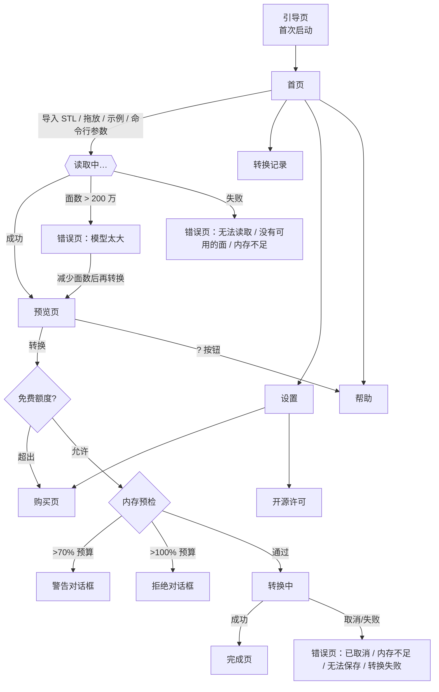

# 完整 UI 参考

[← 返回总入口](../HANDOFF.md)

> 本页逐个页面描述：有哪些元素、每个元素有哪些状态、每个选项的范围/默认值/作用、对应的源文件和文案键。
> 文案原文（中/英）见 [strings.md](strings.md)（300 个键，自动生成）；每个文件用到的全部文案键和 widget Key 见 [screen-map.md](screen-map.md)（自动生成）。
> 截图在 [screenshots/](screenshots/)，由集成测试生成（Linux 桌面，窗口 430×900 模拟手机，像素比 2；26/27 为宽屏）。界面语言默认中文。

## 目录

1. [导航结构](#1-导航结构)
2. [引导页](#2-引导页)
3. [首页（含导入、拖放、示例、最近转换）](#3-首页含导入拖放示例最近转换)
4. [预览页（含全部选项）](#4-预览页含全部选项)
5. [内存预检对话框](#5-内存预检对话框)
6. [转换中（含取消）](#6-转换中含取消)
7. [完成页（STEP / IGES）](#7-完成页step--iges)
8. [错误页](#8-错误页)
9. [错误与状态对照表](#9-错误与状态对照表)
10. [历史、帮助、设置、购买页、开源许可](#10-历史帮助设置购买页开源许可)
11. [页面 ↔ 源文件 ↔ 文案键 ↔ widget Key](#11-页面--源文件--文案键--widget-key)
12. [宽屏分栏、滑动、分享、语言、深浅色、无障碍](#12-宽屏分栏滑动分享语言深浅色无障碍)
13. [截图清单](#13-截图清单)

---

## 1. 导航结构



- 手机布局：每一步是一个压栈的页面。转换中页禁止返回（`PopScope(canPop:false)`），只能取消。
- 宽屏布局（§12）：左栏是首页 + 全部历史，右栏是一个独立的 Navigator 承载预览 → 转换 → 完成/错误。

## 2. 引导页

源文件 `screens/onboarding_screen.dart`；截图：无（集成测试设置了 `onboardingSeen=true` 跳过；组件测试 `onboarding then empty home` 覆盖）。

| 元素 | 说明 | 文案键 |
|---|---|---|
| 右上“跳过” | 直接进入首页，并记住 `onboardingSeen=true` | `common.skip` |
| 第 1 页 | 插图 + 标题 + 正文 | `onboarding.1.title`、`onboarding.1.body` |
| 第 2 页 | 三个步骤 + 隐私提示（蓝色框） | `onboarding.2.title`、`onboarding.2.step1..3`、`onboarding.2.privacy` |
| 底部按钮 | 第 1 页“下一步”，第 2 页“开始使用” | `common.next`、`common.start`（Key `onboardingNext`） |

状态：只在首次启动显示；命令行带 STL 文件启动时自动跳过。

## 3. 首页（含导入、拖放、示例、最近转换）

源文件 `screens/home_screen.dart`、`screens/flow.dart`、`widgets/stl_drop.dart`；截图 01、05、09、26。

| 元素 | 行为 | 文案键 / Key |
|---|---|---|
| 右上“?” | 打开帮助页 | `help.open`（tooltip）/ `helpButton` |
| 右上齿轮 | 打开设置 | `home.settings`（tooltip）/ `settingsButton` |
| 标题 + 标语 | “STL2STP”“让网格模型重新可编辑” | `home.title`、`app.tagline` |
| 演示模式横幅（黄） | 只在找不到核心库或 `STL2STP_DEMO=1` 时显示 | `x.demo_banner` |
| 导入卡片 | 点按 → 系统文件选择器（只选 .stl）；选择器不可用（如 WSLg）时弹“输入 STL 文件路径”对话框 | `home.import`、`home.import_hint`、`x.open_path.*` / `importCard`、`pathField` |
| 拖放（桌面） | 把文件拖进窗口：取第一个 `.stl`；拖入时显示“松开即可导入”；非 STL 提示“只支持 .stl 文件” | `x.drop_here`、`x.drop_not_stl` |
| “从微信 / QQ 导入？” | 底部弹出 3 步说明 | `home.other_ways`、`import.help.*` |
| “用示例模型试试” | 打开内置支架（28 三角形） | `x.sample` / `sampleButton` |
| 最近转换 | 最多几条历史；点按 = 再次分享；文件已删显示“文件已不存在” | `home.recent`、`home.see_all`、`history.missing` |
| 空状态 | 没有历史时显示图标 + 说明 | `home.empty.title`、`home.empty.body` |
| 读取中遮罩 | 导入时显示“正在读取模型…”转圈 | `import.loading` |

导入后的分支：成功 → 预览页；面数 > `AppState.limitFaces`（2,000,000）→ “模型太大”错误页，主按钮进入预览并预填减面比例 = `floor(2,000,000×0.9/面数×100/5)×5`，限制在 5–95%；读取失败 → 错误页（见 §9）。

## 4. 预览页（含全部选项）

源文件 `screens/preview_screen.dart`、`widgets/mesh_viewer.dart`、`core/estimate.dart`；截图 02、03、06、11、18、27。

### 4.1 顶部和模型区

| 元素 | 行为 | 文案键 / Key |
|---|---|---|
| 标题 | 文件名 | — |
| “?” | 打开帮助页（页内各分组标题旁的小“?”会定位到对应主题） | `help.open` / `previewHelp` |
| 文档图标 | 换一个文件 | `preview.replace` |
| 3D 视图 | 单指旋转、双指缩放、双击复位；左上角“二进制 STL / ASCII STL”；大模型显示时抽稀（统计仍是全量） | `preview.format.binary/ascii`、`preview.gesture_hint`、`a11y.viewer` |
| 复位按钮、线框按钮 | 视角复位；线框开关（高亮表示开） | `preview.reset_view`、`preview.wireframe` |
| 统计 4 格 | 三角面、顶点、尺寸（X×Y×Z）、文件大小 | `preview.stats.*` |
| 单位说明 | “STL 不带单位，尺寸按文件中的数值显示（通常是 mm）” | `preview.stats.unit_note` |
| 大模型警告（黄框） | 面数 > 200,000 且未开减面时显示；按钮“减到 50%”打开减面并设 50% | `warn.large.body`、`warn.large.action` |

### 4.2 导出格式

| 选项 | 默认 | 作用 |
|---|---|---|
| STEP | **默认**（可在设置里改默认格式） | 实体；可校验；中文文件信息无损 |
| IGES | | 曲面集合（打开后需在 CAD 里缝合）；不校验；文件信息只保留 ASCII。选中后显示蓝色提示 `warn.iges.surfaces` |

Key `formatSegment`；说明文字 `export.format.step.desc` / `iges.desc`；右侧 `?` 跳到帮助“STEP 和 IGES 有什么区别”。

### 4.3 转换方式（预设）

| 预设 | Key | 等价设置 | 描述文案 |
|---|---|---|---|
| 推荐（默认） | `preset_recommended` | 不减面、ORIGINAL、不合并、校验开、焊接开 | `preset.recommended.desc`“与电脑版一致，速度快” |
| 文件更小 | `preset_smaller` | 减面 50% + 合并共面（其余同推荐） | `preset.smaller.desc` |
| 更严格 | `preset_strict` | SEWING 模式（其余同推荐） | `preset.strict.desc`（注：文案写“约慢一倍”，实测只慢 20–25%，帮助页已改为“通常会慢一些”） |

- 切换预设只改转换参数，**保留格式和文件信息**（`withPreset`）。
- 手动改了高级设置、不再匹配任何预设时，标题旁显示“自定义”（`preset.custom`），三张卡片都不选中。匹配比较的字段：减面开关、（减面时）比例、模式、合并、校验、焊接。
- 进入预览时的初始设置：设置里的“默认方式”——`last`（默认，上次使用的设置 `lastSettings`）或某个预设；默认格式和默认文件信息也会带入。

### 4.4 高级设置（点“高级设置”展开，Key `advancedToggle`；右侧显示当前预设名）

| 选项 | 控件 / Key | 范围 | 默认 | 作用 | 文案键 |
|---|---|---|---|---|---|
| 减少面数 | 开关 `simplifySwitch` | 开/关 | 关 | 先用 QEM 减面 | `advanced.simplify`、`.desc` |
| 保留比例 | 滑块（开关打开后出现） | 5–95%，步长 5（18 格） | 50% | 目标面数 = round(面数×比例)，显示“保留 50%（约 N 面）” | `advanced.simplify.keep` |
| 转换模式 | 分段控件 | 原版 / 缝合 | 原版 | ORIGINAL 或 SEWING，下方显示对应说明 | `advanced.mode.*` |
| 合并重合顶点 | 开关 `weldSwitch` | 开/关 | **开** | 容差焊接（自动容差）；关 = 与电脑版完全一致 | `x.weld`、`x.weld.desc` |
| 合并共面 | 开关 | 开/关 | 关 | 共面三角形合成一个面 | `advanced.merge`、`.desc` |
| 导出后校验 | 开关 | 开/关 | 开 | STEP 写完后回读核对；IGES 时说明变成“IGES 暂不支持校验”（开关值保留但不生效） | `advanced.verify`、`.desc`、`.iges_na` |
| 文件信息 | 4 个输入框：作者、单位/公司、产品名称、描述 | 任意文本 | 空（或设置里的默认文件信息） | 写入文件头；IGES 且含非 ASCII 时显示黄色警告 | `advanced.meta.*` |
| 恢复默认 | 文字按钮 | — | — | 恢复推荐预设（保留格式），并清空 4 个文件信息输入框 | `advanced.reset` |

### 4.5 底部估算和转换按钮

- 估算行（Key `estimateLine`）：“预计用时{time}，文件约 {size}”，右侧小字“估算值，实际以设备为准”。`{time}` 按范围选择文案：`estimate.under_1s`（不到 1 秒）、`est.range_seconds`（约 a–b 秒）、`est.range_seconds_minutes`、`est.range_minutes`。随所有选项实时变化。模型和系数见 [operations.md §2](operations.md#2-估算与内存模型的系数及重新标定)。
- 转换按钮（Key `convertButton`）：“转换为 STEP / IGES”（`convert.button`）。点按依次做：免费额度检查（可能弹购买页）→ 内存预检（可能弹对话框）→ 记住设置 → 进入转换中页。

## 5. 内存预检对话框

源文件 `screens/memory_dialog.dart`、`core/memory_guard.dart`；截图 24。

| 情况 | 标题 / 正文 | 按钮 |
|---|---|---|
| 预计峰值 > 预算的 70% | `x.memory.warn.title` / `x.memory.warn.body`（需要约 {need}，可用约 {budget}） | “仍然转换”（`x.memory.continue`）、“减到 {percent}% 再转换”（`x.memory.simplify`）、取消 |
| 预计峰值 > 预算 | `x.memory.refuse.title` / `x.memory.refuse.body` | 只有“减到 {percent}% 再转换”和取消 |

`{percent}` = 能让峰值回到 70% 以下的最大 5% 档。选“减到…”后以该比例开启减面并直接开始转换。预算的来源见 [operations.md §2.3](operations.md#23-内存模型libcorememory_guarddart)。

## 6. 转换中（含取消）

源文件 `screens/converting_screen.dart`；截图 07（IGES 转换中）。

| 元素 | 说明 | 文案键 / Key |
|---|---|---|
| 标题 | “正在转换”，没有返回按钮 | `converting.title` |
| 进度环 | 总进度 0–100%（阶段权重 读取 10、减面 10、生成 CAD 面 50、写入 20、校验 10；未启用的阶段不计） | `a11y.progress` |
| 输出文件名、已用时间 | 时间每秒刷新，< 60 s 显示“N 秒”，否则 m:ss | `converting.elapsed` |
| 阶段列表 | 读取模型 → （减少面数）→ 生成 CAD 面 → 写入文件 → （校验文件）；已完成打勾、当前高亮、未开始灰色 | `converting.stage.*` |
| 底部提示 | iOS：“可以切到其他 App，转换会在后台继续一小段时间”；其它：“请保持 App 在前台……” | `x.converting.background`、`converting.keep_open` |
| 取消按钮 | 弹确认框：“确定要取消吗？/ 当前进度不会保留。”→“取消转换”（红）/“继续转换” | `converting.cancel`、`cancel.confirm.*` / `cancelButton`、`cancelYes` |

- UI 更新节流到每秒最多 20 次。
- 自动取消：系统内存警告（`didHaveMemoryPressure`）→ 错误页“内存不足”并附说明 `x.memory.pressure`；iOS 后台时间到期 → 错误页“转换失败”并附说明 `x.background.expired`。
- 取消可能不会立即生效：OCCT 的部分阶段没有进度钩子（见 [code-walkthrough.md §3](code-walkthrough.md#3-线程所有权与生命周期规则) 第 5 条）。
- 触感：开始、成功轻触，失败中等（只在手机上）。

## 7. 完成页（STEP / IGES）

源文件 `screens/done_screen.dart`；截图 04（STEP）、08（IGES）、19（焊接关、开放模型）。

| 元素 | 说明 | 文案键 / Key |
|---|---|---|
| 右上“完成” | 回到首页 | `common.done` / `doneButton` |
| 绿色对勾 + “转换完成” | | `done.title` / `doneTitle` |
| 结果卡片 | 格式标签 + 文件名；文件大小、用时（< 10 s 保留一位小数）、实体数（IGES 显示“—”）、CAD 面数 | `done.size`、`done.time`、`done.solids`、`done.faces` |
| 横幅（按顺序） | 见下表 | |
| “分享…” | iOS/Android 系统分享面板；桌面上把路径复制到剪贴板并提示 | `done.share` / `shareButton`、`x.share_unavailable` |
| “存到‘文件’” | 系统保存对话框；不可用时复制路径 | `done.save`、`x.saved_to`、`x.output_path`、`x.copied` |
| 提示 | “发到电脑：用微信‘文件传输助手’或隔空投送” | `done.tip_pc` |
| “再转一个” | 回到首页 | `done.another` |

横幅规则（第一条四选一，其余可叠加）：

| 条件 | 横幅 | 颜色 |
|---|---|---|
| IGES | `done.iges_surfaces`“IGES 打开后是曲面，需要在 CAD 中缝合成实体” | 蓝 |
| STEP 且校验通过 | `done.verify_ok` | 绿 |
| STEP 且校验未通过 | `x.verify_failed`“校验未通过，建议换‘更严格’方式再转一次” | 黄 |
| 关闭了校验 | `done.verify_off`“未校验” | 灰 |
| + WARNING_TARGET_NOT_REACHED | `done.target_not_reached`（已减到 N 面） | 黄 |
| + WARNING_PARTIAL | `done.partial`（个数显示为“?”，核心库没有返回具体数字） | 黄 |
| + WARNING_NOT_SOLID | `x.not_solid`“模型不封闭，已按曲面导出（没有实体）” | 黄 |
| + WARNING_REPAIRED | `x.repaired`“输入模型有瑕疵，已自动修复” | 蓝 |

（WARNING_METADATA_CHANGED 不显示横幅：IGES 的非 ASCII 字符在 Dart 端就已去掉，预览页已有警告。）

## 8. 错误页

源文件 `screens/error_screen.dart`；截图 10（已取消，英文）。

| ErrorKind | 图标颜色 | 标题 / 正文键 | 主按钮 | 次按钮 |
|---|---|---|---|---|
| `format` | 红 | `error.format.*`“无法读取这个文件” | 换一个文件 | 返回 |
| `empty` | 黄 | `error.empty.*`“模型里没有可用的面” | 换一个文件 | 返回 |
| `tooBig` | 黄 | `error.too_big.*`（{faces}、{limit}=2,000,000） | 减少面数后再转换 | 返回 |
| `memory` | 红 | `error.memory.*`“内存不足” | 减到 50% 再试（回预览并开 50% 减面） | 复制错误详情 |
| `cancelled` | 灰 | `error.cancelled.*`“已取消” | 回到预览 | 换一个文件（回首页） |
| `io` | 红 | `error.io.*`“无法保存文件” | 重试（同样参数再转） | 返回 |
| `generic` | 红 | `error.generic.*`“转换失败”（代码 {code}） | 重试 | 复制错误详情 |

“复制错误详情”复制 `code=… faces=… os=…` 和核心库的 `last_error` 文本，用于用户反馈。自动取消时正文下方有黄色说明框（Key `errorNotice`）。

## 9. 错误与状态对照表

| 核心状态（来源阶段） | App 显示 | 用户应该做什么 |
|---|---|---|
| OK | 完成页 + 校验横幅 | — |
| WARNING_PARTIAL（读取） | 完成页 + “有 ? 个三角形无法转换，已跳过” | 检查 STL 是否完整导出 |
| WARNING_TARGET_NOT_REACHED（减面） | 完成页 + “无法再减少，已减到 N 面” | 正常，可接受 |
| WARNING_NOT_SOLID（导出） | 完成页 + “模型不封闭，已按曲面导出” | 在建模软件里修补破洞；或试“更严格”（缝合）；确认“合并重合顶点”是开着的 |
| WARNING_REPAIRED（导出/焊接） | 完成页 + “输入模型有瑕疵，已自动修复” | 一般无需处理 |
| WARNING_METADATA_CHANGED | 不单独显示（预览页已警告） | 需要中文请选 STEP |
| 校验失败（verified=false） | 完成页 + “校验未通过，建议换‘更严格’方式” | 用“更严格”再转 |
| ERROR_FORMAT / ERROR_IO（读取阶段） | 错误页 format | 确认是 STL；重新导出 |
| ERROR_EMPTY | 错误页 empty | 文件里没有三角形，换文件 |
| 面数 > 2,000,000（读取后） | 错误页 tooBig | 减面后转换，或用电脑版 |
| ERROR_MEMORY | 错误页 memory | 减到 50% 再试；关闭其他 App |
| ERROR_CANCELLED（用户取消） | 错误页 cancelled | — |
| ERROR_CANCELLED（系统内存警告） | 错误页 memory + 说明 | 减面再试 |
| ERROR_CANCELLED（后台时间到期） | 错误页 generic + 说明 | 保持 App 在前台重试 |
| ERROR_IO（写入阶段） | 错误页 io | 清理存储空间后重试 |
| ERROR_ARGUMENT / ERROR_OCCT / ERROR_INTERNAL / 工作 isolate 崩溃 | 错误页 generic（代码 -1 / -6 / -8） | 复制错误详情反馈给我们；可先试“更严格” |
| 免费额度超出 | 购买页（说明原因） | 购买或减面 |
| 内存预检 > 70% / > 100% | 对话框（§5） | 按建议减面 |

## 10. 历史、帮助、设置、购买页、开源许可

### 10.1 转换记录（`screens/history_screen.dart`、`widgets/history_list.dart`；截图 25）

- 列表项：格式标签、文件名、副标题（当天显示 `HH:mm`，否则 `M/D HH:mm`，再加 ` · 文件大小`）；文件不存在时显示“文件已不存在”。
- 顶部提示“向右滑动再次分享，向左滑动删除”+“记录和文件只保存在本机，删除 App 后会一起删除”。
- **右滑**：分享（文件不存在时弹 SnackBar“‘{name}’已不存在，无法分享”，带“删除记录”按钮，Key `historyMissingSnack`）。**左滑**：删除记录和文件。
- 右上“清空记录”→ 确认框 `x.clear_confirm`。空状态 `history.empty`。

### 10.2 帮助（`screens/help_screen.dart`；截图 12、13、17、20）

主题顺序（`helpTopics`）：`formats` 支持哪些文件 → `step_iges` STEP 和 IGES 有什么区别 → `presets` 三种转换方式 → `mode` 原版模式和缝合模式 → `weld` 合并重合顶点 → `merge` 合并共面 → `simplify` 为什么要减少面数 → `units` 尺寸和单位 → `estimate` 预计用时和大小 → `meta` 文件信息；然后 FAQ 6 条（可展开，Key `faq1..6`）和隐私（绿框）。每个主题的正文键是 `help.<id>.body`（多段用换行分隔）。从预览页各处的“?”进入时自动滚动到对应主题。

### 10.3 设置（`screens/settings_screen.dart`；截图 14、16）

| 分组 | 项 | 选项 / 行为 | 默认 |
|---|---|---|---|
| 购买（黄框，占位） | 当前版本 | “免费版（占位）”/“完整版（已解锁）”，点按 → 购买页 | 免费版 |
| | 恢复购买 | 调 `restore()`，结果用 SnackBar 提示 | |
| | 重置购买状态（开发用） | 只有模拟商店时显示 | |
| 默认转换设置 | 默认格式 | STEP / IGES | STEP |
| | 默认方式 | 推荐 / 文件更小 / 更严格 / 上次使用 | 上次使用（注：“上次使用”四个字写死在代码里，未进文案表） |
| | 默认文件信息 | 对话框：作者、单位/公司、产品名称、描述 | 未设置 |
| 外观 | 外观 | 跟随系统 / 浅色 / 深色 | 跟随系统 |
| | 语言 | 中文 / English / 跟随系统 | 中文 |
| 关于 | 使用帮助 | 打开帮助（Key `settingsHelp`） | |
| | 版本 | 显示 `0.1.0`（写死，见已知问题） | |
| | 隐私 | “全部本机处理，不上传” | |
| | 转换引擎 | 如 `stl2stp-core (FFI: libstl2stp-core.so)`；演示模式显示演示引擎 | |
| | 开源许可 | → 许可页 | |
| | 意见反馈 | 显示“—”（还没有反馈渠道） | |
| 底部 | 说明文字 | “转换引擎：stl2stp-core，基于 Open CASCADE Technology” | |
| | 清空转换记录（红） | 确认后清空 | |

### 10.4 购买页（`screens/paywall_screen.dart`；截图 15）

- 黄色占位横幅：“【占位】价格、购买方式和免费额度都还没有确定……”；模拟商店时还有蓝色“开发用模拟商店：不会扣费”。
- 因额度触发时顶部说明原因：`purchase.limit.triangles` / `daily` / `iges` / `meta`。
- 标题“解锁完整版”，4 项权益（不限次数、大模型、IGES、自定义文件信息），每项后标“待定”。
- 免费版说明 `paywall.free_limit`（“【额度待定】”）。
- 按钮：购买（商店返回价格时显示“购买 {price}”，否则“购买（价格待定）”，Key `buyButton`；进行中显示转圈并禁用）、恢复购买（`restoreButton`）、以后再说。
- 结果提示：成功 / 已恢复 / 没有可恢复的购买 / 已取消 / 等待中 / 商店不可用 / 失败（`purchase.*`）。已是完整版时显示绿色“完整版（已解锁）”。

### 10.5 开源许可（`screens/licenses_screen.dart`；截图 21、22、23）

OCCT：名称、LGPL-2.1 + OCCT 例外说明、源码获取方式（`x.licenses.occt_source`）、可展开的许可原文（Key `occtLicenseText`，来自 `assets/licenses/occt/`）；stl2stp-core 说明；“其他开源组件”→ Flutter 自带的 `showLicensePage`（列出所有 Dart/Flutter 包许可）。

## 11. 页面 ↔ 源文件 ↔ 文案键 ↔ widget Key

完整列表（自动生成）：[screen-map.md](screen-map.md)。重新生成：

```bash
cd "$(git rev-parse --show-toplevel)/mobile" && python3 app/tool/gen_ui_docs.py
# 输出：strings.md: 300 keys; screen-map.md: 17 files
```

| 页面 | 主要源文件 | 文案键前缀 | 主要 Key |
|---|---|---|---|
| 引导 | `screens/onboarding_screen.dart` | `onboarding.*`、`common.*` | `onboardingNext` |
| 首页 | `screens/home_screen.dart`、`widgets/stl_drop.dart` | `home.*`、`import.*`、`x.sample`、`x.drop_*`、`x.split.placeholder` | `importCard`、`sampleButton`、`helpButton`、`settingsButton`、`splitLeft` |
| 导入流程 | `screens/flow.dart` | `x.open_path.*`、`import.loading`、`x.share_unavailable`、`x.saved_to` | `pathField` |
| 预览 | `screens/preview_screen.dart`、`widgets/mesh_viewer.dart` | `preview.*`、`export.*`、`preset.*`、`advanced.*`、`x.weld*`、`estimate.*`、`est.*`、`warn.*`、`convert.button` | `formatSegment`、`preset_*`、`advancedToggle`、`simplifySwitch`、`weldSwitch`、`estimateLine`、`convertButton`、`previewHelp` |
| 内存对话框 | `screens/memory_dialog.dart` | `x.memory.*` | |
| 转换中 | `screens/converting_screen.dart` | `converting.*`、`cancel.confirm.*` | `cancelButton`、`cancelYes` |
| 完成 | `screens/done_screen.dart` | `done.*`、`x.not_solid`、`x.repaired`、`x.verify_failed` | `doneButton`、`doneTitle`、`shareButton` |
| 错误 | `screens/error_screen.dart` | `error.*` | `errorTitle`、`errorPrimary`、`errorNotice` |
| 历史 | `screens/history_screen.dart`、`widgets/history_list.dart` | `history.*`、`x.history.*`、`x.clear_confirm` | `historyMissingSnack` |
| 帮助 | `screens/help_screen.dart` | `help.*` | `faq1..6` |
| 设置 | `screens/settings_screen.dart` | `settings.*`、`x.language.*`、`x.engine`、`x.reset_purchase` | `languageDropdown`、`settingsHelp` |
| 购买 | `screens/paywall_screen.dart` | `paywall.*`、`purchase.*` | `buyButton`、`restoreButton` |
| 许可 | `screens/licenses_screen.dart` | `licenses.*`、`x.licenses.*` | `occtLicenseText` |

## 12. 宽屏分栏、滑动、分享、语言、深浅色、无障碍

- **宽屏分栏（iPad / 宽窗口）**：宽度 ≥ 900，或（最短边 ≥ 600 且宽度 ≥ 700）时启用（`splitMinWidth`、`splitTabletWidth`）。左栏（Key `splitLeft`）= 首页内容 + 全部历史；右栏 = 独立 Navigator（`detailNavigatorKey`），预览 → 转换 → 完成/错误都在右栏进行，未打开模型时显示占位“在左边导入 STL，或从记录里分享”（`x.split.placeholder`）。预览页宽度 ≥ 760 时采用双列布局。截图 26、27。注意：800×600 的窗口满足条件，会被当作平板。
- **历史滑动**：见 §10.1。
- **拖放**：见 §3，仅桌面（`desktop_drop`）。
- **分享**：`share_plus`（iOS 分享面板，iPad 上以按钮位置为锚点）；桌面没有分享面板 → 复制路径。
- **语言**：中文（默认）/ English / 跟随系统（系统语言是英文时用英文，其它一律中文）。所有文案在 4 个 JSON 里；文案风格见 `design/ui/ui-spec.md §10`（简短、平实、不用感叹号、中文用“”引号）。
- **深浅色**：`theme/tokens.dart` 定义浅色/深色两套令牌，默认跟随系统，设置里可强制。**深色模式没有截图核对过**【未验证】。
- **无障碍**：所有图标按钮都有 tooltip（读屏会读出）；3D 视图有语义标签“3D 预览，{name}，可旋转缩放”（`a11y.viewer`）；预设卡片标注 selected/button 语义；进度文案 `a11y.progress`（“转换进度 {pct}%”）已在文案表中，但代码里还没有接上（见 strings.md 中标“—”的键）；引导页插图 `ExcludeSemantics`。字体大小跟随系统设置（未做大字号专项测试）。

## 13. 截图清单

| 文件 | 页面 / 状态 |
|---|---|
| [01_home_empty](screenshots/01_home_empty.png) | 首页，空状态 |
| [02_preview](screenshots/02_preview.png) | 预览（示例支架，推荐预设） |
| [03_preview_advanced](screenshots/03_preview_advanced.png) | 预览，展开高级设置前的格式/预设区 |
| [04_done_step](screenshots/04_done_step.png) | 完成页，STEP，校验通过 |
| [05_home_recent](screenshots/05_home_recent.png) | 首页，有最近转换 |
| [06_preview_sphere_iges](screenshots/06_preview_sphere_iges.png) | 预览，球，IGES（蓝色提示） |
| [07_converting](screenshots/07_converting.png) | 转换中 |
| [08_done_iges](screenshots/08_done_iges.png) | 完成页，IGES |
| [09_home_en](screenshots/09_home_en.png) | 首页，英文 |
| [10_cancelled_en](screenshots/10_cancelled_en.png) | 已取消（英文） |
| [11_preview_smaller_estimate](screenshots/11_preview_smaller_estimate.png) | “文件更小”预设的估算范围 |
| [12_help_zh](screenshots/12_help_zh.png) | 帮助（中文） |
| [13_help_faq_zh](screenshots/13_help_faq_zh.png) | 帮助 FAQ |
| [14_settings_free](screenshots/14_settings_free.png) | 设置（免费版） |
| [15_paywall_zh](screenshots/15_paywall_zh.png) | 购买页 |
| [16_settings_pro](screenshots/16_settings_pro.png) | 设置（完整版） |
| [17_help_en](screenshots/17_help_en.png) | 帮助（英文） |
| [18_preview_weld_toggle](screenshots/18_preview_weld_toggle.png) | 高级设置里的“合并重合顶点” |
| [19_done_weld_off_open](screenshots/19_done_weld_off_open.png) | 焊接关闭时开放模型的完成页（不封闭警告） |
| [20_help_weld](screenshots/20_help_weld.png) | 帮助“合并重合顶点” |
| [21_licenses](screenshots/21_licenses.png) | 开源许可 |
| [22_occt_license_text](screenshots/22_occt_license_text.png) | OCCT 许可原文 |
| [23_package_licenses](screenshots/23_package_licenses.png) | Flutter 包许可列表 |
| [24_memory_warning](screenshots/24_memory_warning.png) | 内存警告对话框 |
| [25_history_swipe_share](screenshots/25_history_swipe_share.png) | 历史右滑分享 |
| [26_wide_split_home](screenshots/26_wide_split_home.png) | 宽屏分栏首页 |
| [27_wide_split_preview](screenshots/27_wide_split_preview.png) | 宽屏分栏，右栏预览 |

没有截图的状态：引导页、各类错误页（format/empty/tooBig/memory/io/generic）、大模型警告、拒绝对话框、微信/QQ 导入说明、全部历史页、深色模式。需要时在 `integration_test/app_test.dart` 里加 `shot()` 调用（见 [build-test.md §8](build-test.md#8-截图的重新生成)）。
